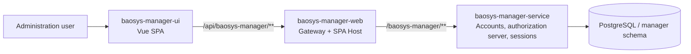
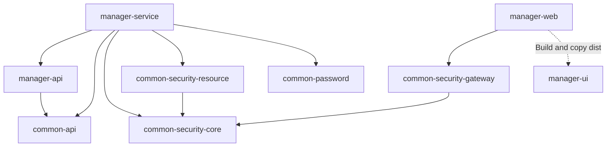

# BaoSys system architecture

[简体中文](system_architecture.md) | **English**

This document describes the repository's current modules, call flow, and boundaries. Implementation references include the [root POM](../../pom.xml), [Manager configuration](../../baosys-manager/baosys-manager-service/src/main/resources/application.yml), and [gateway configuration](../../baosys-manager-web/src/main/resources/application.yml).

## 1. System context

The runnable application consists of UI, Manager Web, Manager Service, and PostgreSQL. The default gateway configures only Manager routes; there is no Plant route or Plant service. `CAT` in the system catalog is an assignable system access permission, not evidence that the corresponding business service exists in the repository.

## 2. Layer responsibilities

| Layer | Module | Current responsibilities |
|---|---|---|
| Frontend | manager-ui | Vue pages, routing, localization, in-memory user state, permission display, Axios requests, CSRF acquisition, and refresh with a single retry after 401 |
| Access | manager-web | API routing, shared Cookie/Bearer JWT authentication, configured system access authorization, CSRF, Bearer forwarding, static resources, and SPA fallback |
| Business | manager-service | Shared login, OAuth2/OIDC authorization server, account CRUD, permission catalog, login records, revocation, and auditing |
| Shared contracts | common-api | `ApiResponse<T>` and `PageResponse<T>` |
| Shared security | common-security-core | Security configuration properties, JWT validation contract, permission conversion, shared cookie constants |
| Servlet security | common-security-resource | JWT decoder, stateless resource service chain, method authorization enablement |
| Gateway security | common-security-gateway | Reactive JWT decoder, security chain, CSRF endpoint, token relay, optional external OAuth2 client integration |
| Passwords | common-password | BCrypt, password interfaces, and auto-configuration |

Manager Service uses `app + infra` layers. Controllers call application services, which orchestrate mappers and infrastructure. `app/services/BrowserAuthAppService` orchestrates shared login; `app/services/impl/BrowserLoginTransaction` handles login completion, refresh, and logout transactions; `infra/security/AccountAuthenticator` checks passwords outside transactions. There is no separate Domain/Agent layer.

JWT issuance lives in Manager Service. There is no separate issuer module or `baosys-common` compatibility entry point. The gateway does not access business databases, and frontend permission display is not a trusted authorization boundary.

## 3. Build dependencies

Arrows below represent direct project module dependencies, not root POM aggregation:

The root reactor aggregates five shared modules, the Manager aggregator, and Manager Web. The Manager aggregator includes API and Service. Manager Web's build plugin integrates the UI. See [Maven dependency boundaries](dependency-boundaries.en.md) for scopes and verification.

## 4. HTTP path model

| Layer | Manager example |
|---|---|
| Browser entry | `/api/baosys-manager/v1/users` |
| Gateway match | `/api/baosys-manager/**` |
| After `StripPrefix=1` | `/baosys-manager/v1/users` |
| Service context path | `/baosys-manager` |
| API prefix | `/v1/users` |

The gateway provides `/api/baosys-manager/csrf`; `/baosys-manager/login` is the Vue login page. Server-side OAuth2/OIDC endpoints use Manager Service's context path. The gateway currently has no additional dedicated forwarding routes for these protocol endpoints.

## 5. Authentication and authorization flow

Internal browsers submit credentials through the Manager login page. `/v1/browser-auth/login` issues HttpOnly Access/Refresh cookies shared on the same host. Cookies do not distinguish ports. Allowed return origins must satisfy the configured host, protocol, and origin allowlist.

The gateway establishes JWT identity from an explicit Authorization header or the Access Cookie. An explicit header takes precedence, with no cookie fallback even if invalid. Authorization then uses the first matching rule in `spring.security.gateway.access-rules`:

1. `/api/baosys-manager/v1/users/me` and `/api/baosys-manager/v1/systems` require authentication only.
2. `/api/baosys-manager/**` requires the `MGR` authority.
3. Other unconfigured `/api/**` paths are denied.
4. Shared login endpoints in `permit-all-paths` are treated as public first; writes remain subject to CSRF and server-side Origin checks.

The gateway removes spoofable user/tenant identity headers and forwards a Bearer token from the authenticated JWT. Service verifies the signature again and checks specific API permissions with `@PreAuthorize`. Resource services do not apply a universal system access permission check.

Business Access JWTs use `permissions` as their sole authorization source and do not issue `scope`, `system_type`, or `systemType`. JWT `sub` is the login record ID; current-user lookup resolves it to an account ID.

Manager UI attempts one shared refresh for 401 responses from non-authentication APIs and coalesces concurrent refresh requests. Refresh failure or another 401 after retry leads to login; 403 does not trigger refresh. Spring Authorization Server provides external OAuth2/OIDC authorization code flows, sharing authorization persistence and account revocation with internal cookie login. See [Authentication and sessions](../modules/manager/auth_and_session.en.md).

## 6. Data ownership

Manager owns the PostgreSQL `manager` schema by default. The sole migration, `V1__init_manager.sql`, creates seven business/framework tables:

- `user_info`, `user_login`, and `permission_change_audit`.
- `oauth2_authorization` and `oauth2_authorization_consent`.
- `spring_session` and `spring_session_attributes`.

Flyway separately maintains `flyway_schema_history_manager`. V1 also creates the cleanup function and authorization revocation triggers. There is no V2/V3/V4 upgrade chain; V1 is not an upgrade script for an old database. See [Database design](../modules/manager/database_design.en.md) for schemas and lifecycles.

Other business services should cooperate through public APIs rather than reading Manager tables directly. Entities do not cross service boundaries. Common API holds shared responses, and each business API JAR owns its DTOs.

## 7. Configuration and deployment

| Unit | Default port | Artifact / notes |
|---|---:|---|
| Manager Service | 9090 | `baosys-manager.jar` |
| Manager Web | 8080 | `baosys-manager-web.jar`, including Vue production resources |
| PostgreSQL | 5432 | Default database `app_db`, schema `manager` |
| Vite development server | 5173 | Frontend development only |

`JWT_JWK_SET_LOCATION` points to an external persistent signing JWK file; `OAUTH2_CLIENT_SECRET_HASH` supplies the OAuth2 client secret. Explicitly align `JWT_ISSUER`: the current authorization-server/gateway default is `baosys-manager`, while the Manager resource-server default is `http://localhost:9090/baosys-manager`. Using these defaults together causes issuer validation failures.

The system and permission catalog comes from the root [baosys-systems.yml](../../baosys-systems.yml), copied into Manager Service at build time. `BAOSYS_SYSTEMS_CONFIG` can select an external catalog at runtime. The current catalog contains MGR and CAT. Configuration changes require a restart; there is no online catalog editing API.

## 8. Cross-cutting capabilities and current boundaries

| Capability | Implementation |
|---|---|
| Response wrappers and pagination | common-api |
| Business exceptions and Trace ID | Manager `GlobalExceptionHandler` and `TraceIdFilter` |
| Log formatting | Executable modules' `logback-spring.xml` |
| Health checks | Spring Boot Actuator |
| Database migrations | Manager Flyway |
| Account authorization auditing | `permission_change_audit`, in the account write transaction |
| Account revocation | Application services and database triggers |
| Frontend build | Manager Web Maven plugin |

Roles, organizations, tenants, data permissions, Redis, message queues, and a distributed tracing platform are not implemented. Nacos dependencies and configuration are commented examples only; default routing uses fixed service URLs.

A new service requires API/Service modules, independent data ownership, gateway routes, `access-rules`, and system permission catalog updates. A catalog entry alone creates neither a service nor a route. See the [Manager permission model](../modules/manager/permission_model.en.md).
