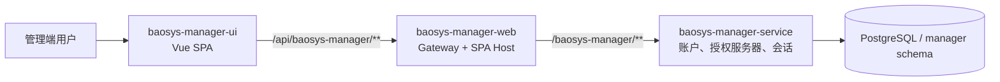
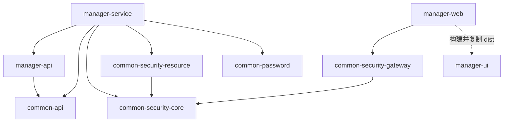

# BaoSys 系统总体架构

本文描述当前仓库的实际模块、调用链和边界。实现依据包括 [根 POM](../../pom.xml)、[Manager 配置](../../baosys-manager/baosys-manager-service/src/main/resources/application.yml) 和 [网关配置](../../baosys-manager-web/src/main/resources/application.yml)。

## 1. 系统上下文

当前可运行闭环由 UI、Manager Web、Manager Service 和 PostgreSQL 组成。默认网关只配置 Manager 路由，没有 Plant 路由或 Plant 服务。系统目录中的 `CAT` 是可分配的系统入口，并不代表仓库已经实现对应业务服务。

## 2. 分层职责

| 层次 | 模块 | 当前职责 |
|---|---|---|
| 前端 | manager-ui | Vue 页面、路由、多语言、内存用户状态、权限展示、Axios 请求、CSRF 获取、401 后单次重试刷新 |
| 接入 | manager-web | API 路由、共享 Cookie/Bearer JWT 认证、按配置执行入口授权、CSRF、Bearer 转发、静态资源和 SPA 回退 |
| 业务 | manager-service | 共享登录、OAuth2/OIDC 授权服务器、账户 CRUD、权限目录、登录记录、撤销和审计 |
| 公共协议 | common-api | `ApiResponse<T>`、`PageResponse<T>` |
| 公共安全 | common-security-core | 安全配置属性、JWT 校验契约、权限转换、共享 Cookie 常量 |
| Servlet 安全 | common-security-resource | JWT decoder、无状态资源服务链、方法级授权启用 |
| 网关安全 | common-security-gateway | 响应式 JWT decoder、安全链、CSRF 端点、Token relay、可选外部 OAuth2 客户端适配 |
| 密码 | common-password | BCrypt 与密码接口/自动配置 |

Manager Service 使用 `app + infra` 分层：Controller 调用应用服务，应用服务编排 Mapper 和基础设施。共享登录由 `app/services/BrowserAuthAppService` 编排，`app/services/impl/BrowserLoginTransaction` 承担登录完成、刷新和退出事务，`infra/security/AccountAuthenticator` 负责事务外密码校验。当前没有独立 Domain/Agent 层。

JWT 签发位于 Manager Service，当前没有独立 issuer 模块或 `baosys-common` 兼容入口。网关不访问业务数据库，前端权限展示也不构成可信授权边界。

## 3. 构建依赖

以下箭头表示直接的项目模块依赖，不表示根 POM 聚合关系：

根 Reactor 聚合五个公共模块、Manager 聚合模块和 Manager Web；Manager 聚合模块包含 API 和 Service。UI 由 Manager Web 构建插件集成。详细作用域和验证方式见 [Maven 依赖边界](dependency-boundaries.md)。

## 4. HTTP 路径模型

| 层次 | Manager 示例 |
|---|---|
| 浏览器入口 | `/api/baosys-manager/v1/users` |
| 网关匹配 | `/api/baosys-manager/**` |
| `StripPrefix=1` 后 | `/baosys-manager/v1/users` |
| 服务 context-path | `/baosys-manager` |
| API 前缀 | `/v1/users` |

`/csrf` 由网关提供，`/login` 是 Vue 登录页。服务端 OAuth2/OIDC 端点使用 Manager Service 的 context-path，当前网关没有额外配置这些协议端点的专用转发路由。

## 5. 认证与授权链路

内部浏览器通过 Manager 登录页提交用户名和密码，由 `/v1/browser-auth/login` 下发同主机共享的 HttpOnly Access/Refresh Cookie。Cookie 不区分端口；允许返回的来源必须满足配置的主机、协议和来源名单。

网关从显式 Authorization 头或 Access Cookie 建立 JWT 身份。显式头优先，即使无效也不回退到 Cookie。随后根据 `spring.security.gateway.access-rules` 按顺序首次匹配授权：

1. `/api/baosys-manager/v1/users/me` 和 `/api/baosys-manager/v1/systems` 仅要求登录。
2. `/api/baosys-manager/**` 要求 `MGR` authority。
3. 其他未配置的 `/api/**` 拒绝访问。
4. `permit-all-paths` 中的共享登录接口先按公开路径处理；写请求仍受 CSRF 和服务端 Origin 检查。

网关清理可伪造的用户/租户身份头，并从已认证 JWT 向下游写入 Bearer。服务再次验签，使用 `@PreAuthorize` 校验具体接口权限。资源服务没有统一的系统入口权限检查。

业务 Access JWT 以 `permissions` 为唯一权限来源，不签发 `scope`、`system_type` 或 `systemType`。JWT 的 `sub` 是登录记录 ID；当前用户查询再解析为账户 ID。

Manager UI 对非认证接口的 401 尝试一次共享刷新，并合并并发刷新请求；刷新失败或重试仍为 401 时进入登录页，403 不触发刷新。外部 OAuth2/OIDC 授权码流程由 Spring Authorization Server 提供，与内部 Cookie 登录共用授权持久化和账户撤销机制。详见 [认证与会话](../modules/manager/auth_and_session.md)。

## 6. 数据所有权

Manager 默认独占 PostgreSQL 的 `manager` schema，唯一迁移 `V1__init_manager.sql` 创建七张业务/框架表：

- `user_info`、`user_login`、`permission_change_audit`。
- `oauth2_authorization`、`oauth2_authorization_consent`。
- `spring_session`、`spring_session_attributes`。

Flyway 另维护 `flyway_schema_history_manager`。V1 同时创建空闲清理函数和授权撤销触发器。当前仓库没有 V2/V3/V4 升级链，不能将 V1 当成旧数据库升级脚本。表结构及生命周期见 [数据库设计](../modules/manager/database_design.md)。

其他业务服务应通过公开 API 协作，不直接读取 Manager 表；Entity 不跨服务传输。通用响应在 Common API，业务 DTO 在所属 API Jar。

## 7. 配置和部署

| 单元 | 默认端口 | 产物/说明 |
|---|---:|---|
| Manager Service | 9090 | `baosys-manager.jar` |
| Manager Web | 8080 | `baosys-manager-web.jar`，包含 Vue 生产资源 |
| PostgreSQL | 5432 | 默认数据库 `app_db`，schema `manager` |
| Vite 开发服务器 | 5173 | 仅前端开发 |

签名密钥由 `JWT_JWK_SET_LOCATION` 指向外部持久化 JWK 文件，OAuth2 客户端密钥由 `OAUTH2_CLIENT_SECRET_HASH` 提供。必须显式统一 `JWT_ISSUER`：当前授权服务器/网关默认是 `baosys-manager`，Manager 资源服务器默认却是 `http://localhost:9090/baosys-manager`，直接使用各自默认值会导致验签 issuer 不一致。

系统与权限目录来自根 [baosys-systems.yml](../../baosys-systems.yml)，构建时复制进 Manager Service，运行时可用 `BAOSYS_SYSTEMS_CONFIG` 指向外部配置。当前目录为 MGR 和 CAT。配置变更需要重启加载，没有在线编辑目录 API。

## 8. 横切能力与当前边界

| 能力 | 实现位置 |
|---|---|
| 响应包装与分页 | common-api |
| 业务异常与 Trace ID | Manager `GlobalExceptionHandler`、`TraceIdFilter` |
| 日志格式 | 可启动模块的 `logback-spring.xml` |
| 健康检查 | Spring Boot Actuator |
| 数据迁移 | Manager Flyway |
| 账户授权审计 | `permission_change_audit`，与账户写操作同事务 |
| 账户撤销 | 应用服务与数据库触发器 |
| 前端构建 | Manager Web Maven 插件 |

当前没有角色、组织、租户、数据权限、Redis、消息队列或分布式追踪平台。Nacos 依赖和配置仅为注释示例；默认通过固定服务 URL 路由。

增加新服务时应同时维护 API/Service 模块、独立数据所有权、网关路由、`access-rules` 及系统权限目录。仅增加目录项不会创建服务或路由。当前权限模型详见 [Manager 权限模型](../modules/manager/permission_model.md)。
