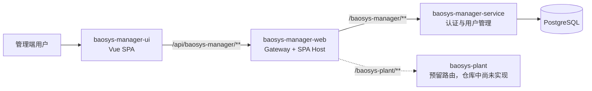
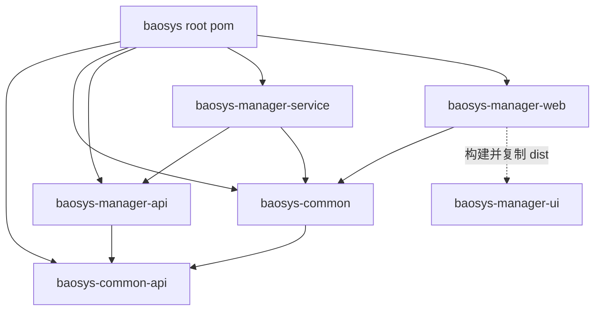
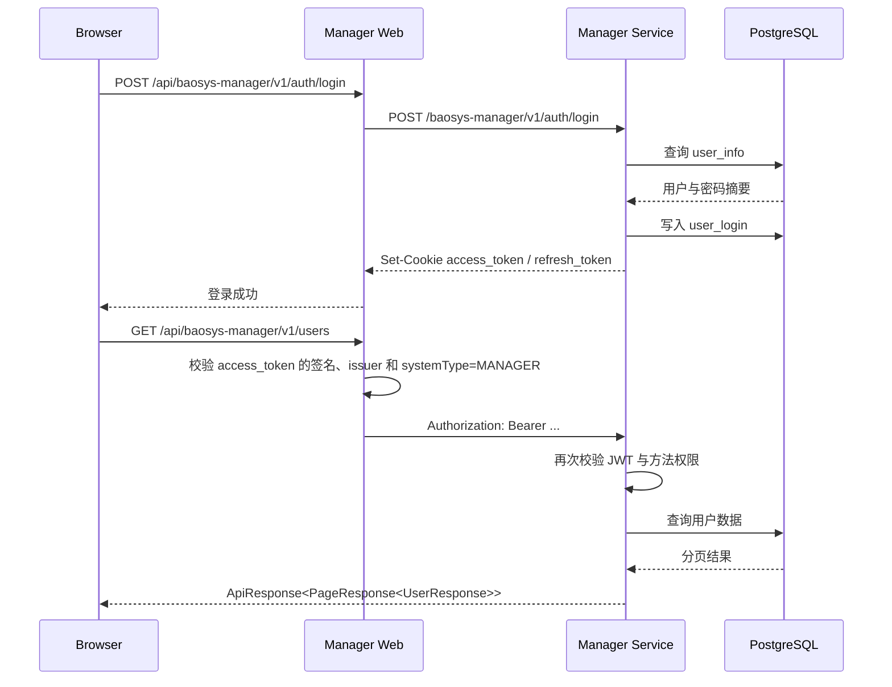

# BaoSys 系统总体架构

## 1. 文档目的

本文描述当前 BaoSys 仓库的系统边界、模块职责、依赖关系、运行时调用链和扩展约束。微服务内部的详细目录规则参见 [微服务模块架构规范](../microservices_module_architecture_standard.md)。

## 2. 系统上下文

当前可运行闭环由 Manager UI、Manager Web、Manager Service 和 PostgreSQL 组成。

## 3. 架构分层

### 3.1 前端层

`baosys-manager-ui` 负责：

- 页面渲染、路由和多语言。
- 当前用户内存状态。
- 调用统一 Axios 请求封装。
- 401 后的单次并发刷新。
- 根据权限编码控制菜单和操作入口。

前端不作为可信授权边界，最终权限判断由后端执行。

### 3.2 接入层

`baosys-manager-web` 基于 Spring Cloud Gateway WebFlux，负责：

- `/api/{service}/**` 路由。
- Cookie 中访问令牌的识别和校验。
- 向下游转发标准 Bearer Token。
- 可选双提交 CSRF 校验。
- 统一认证失败响应。
- Vue 构建产物托管和 SPA 路由回退。

接入层不包含业务 CRUD，不直接访问业务数据库。

### 3.3 业务服务层

`baosys-manager-service` 是 Servlet Web 应用，负责：

- 用户名密码认证。
- Access Token 与 Refresh Token 签发。
- 用户和权限配置。
- 登录会话查询与撤销。
- 数据库事务和业务校验。
- JWT 的资源服务校验与方法级授权。

当前 Manager 业务以 CRUD 和流程编排为主，采用 `app + infra` 简单分层。

### 3.4 公共能力层

`baosys-common-api` 提供跨服务协议：

- `ApiResponse<T>`。
- `PageResponse<T>`。

`baosys-common` 提供可复用实现：

- BCrypt 密码处理。
- RSA JWT 编码与解码。
- 网关认证过滤器。
- 资源服务权限转换。
- Spring Boot 自动配置与启用注解。

接入方式、配置默认值及边界参见 [Common 模块说明](../../baosys-common/README.md)。

### 3.5 数据层

Manager 当前独占自己的业务表：

- `user_info`：账户、系统类型和权限。
- `user_login`：登录客户端和刷新令牌状态。
- `permission_change_audit`：账号授权和启停变更审计。

默认使用独立的 `manager` schema。首版由 `V1__init_manager.sql` 创建三张表及会话清理函数，后续结构变更由新 Flyway 迁移管理。

## 4. 构建时模块依赖

依赖约束：

1. API Jar 不依赖实现 Jar。
2. 业务服务之间只通过 API Jar 或网络契约协作。
3. Common 不依赖具体业务模块。
4. UI 不加入 Maven Reactor，由 Manager Web 构建插件集成。

## 5. HTTP 路径模型

路径由网关入口、服务 context-path 和 Controller 前缀共同组成：

| 层次 | Manager 示例 |
|---|---|
| 浏览器入口 | `/api/baosys-manager/v1/users` |
| 网关匹配 | `/api/baosys-manager/**` |
| `StripPrefix=1` 后 | `/baosys-manager/v1/users` |
| Manager context-path | `/baosys-manager` |
| `UserApi.PREFIX` | `/v1/users` |

业务 API 只维护 `/v1/**`；`/api/{service}` 是接入层约定。

## 6. 认证请求链路

认证和会话细节参见 [认证与会话设计](../modules/manager/auth_and_session.md)。

## 7. 数据所有权

当前规则：

1. 每个业务服务拥有自己的表和 Flyway 迁移。
2. 其他服务禁止直接读取 Manager 表。
3. 跨服务数据通过公开 API 或事件交换。
4. 数据库 Entity 不跨服务传输。
5. 统一协议放在 Common API，业务 DTO 放在所属服务 API Jar。

后续拆分独立数据库实例时，不应改变服务契约和上层调用方式。

## 8. 横切能力

| 能力 | 当前实现位置 |
|---|---|
| 统一响应 | `baosys-common-api` |
| 密码和 JWT | `baosys-common` |
| 网关认证 | `baosys-common` + `baosys-manager-web` |
| 服务授权 | `baosys-common` + `@PreAuthorize` |
| Trace ID | Manager Service `TraceIdFilter` |
| 日志格式 | 各可启动模块 `logback-spring.xml` |
| 健康检查 | Spring Boot Actuator |
| 数据迁移 | Manager Service Flyway |
| 前端构建 | Manager Web `frontend-maven-plugin` |

## 9. 部署单元

当前部署单元：

| 单元 | 默认端口 | 产物 |
|---|---:|---|
| Manager Service | 9090 | `baosys-manager.jar` |
| Manager Web | 8080 | `baosys-manager-web.jar` |
| PostgreSQL | 5432 | 外部服务或容器 |

Vue 生产资源被打包进 Manager Web Jar，不需要单独部署；开发模式使用 Vite 5173 端口。

## 10. 扩展新服务

新增 `baosys-xxx` 时：

1. 创建 `baosys-xxx-api` 和 `baosys-xxx-service`。
2. API Jar 定义 `/v1/**` 契约。
3. Service 独占数据表和迁移。
4. Manager Web 增加 `/api/baosys-xxx/**` 路由。
5. 调用方仅依赖 `baosys-xxx-api`。
6. 根据业务复杂度选择简单分层或 Domain/Agent 分层。

完整步骤参见 [新微服务创建清单](../microservices_module_architecture_standard.md#17-新微服务创建清单)。

## 11. 当前边界与演进方向

当前未实现：

- 服务注册中心的实际接入；Nacos 配置仅保留注释示例。
- 消息队列和异步事件总线。
- Redis 缓存。
- 分布式追踪平台。
- 角色、组织、租户和数据权限。
- Plant 业务服务。

演进时优先保持模块边界和 API 稳定，不应在网关或 Common 中堆叠业务逻辑。
