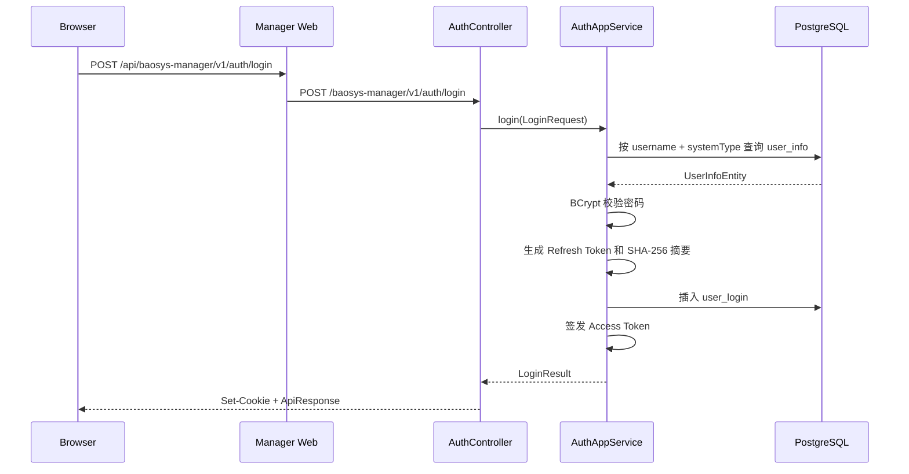
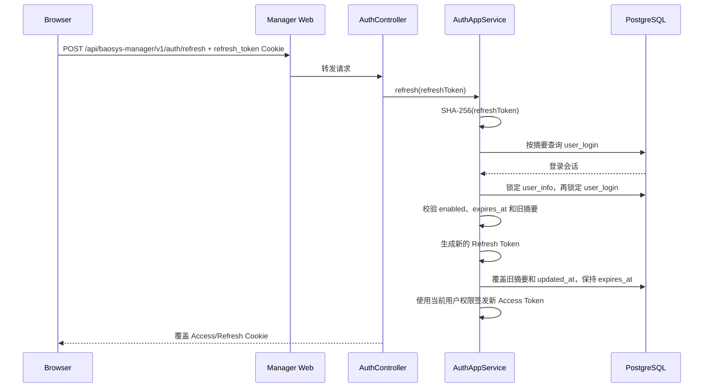

# Manager 认证与会话设计

## 1. 范围

本文描述当前 Manager 的登录、JWT、刷新令牌、Cookie、前端会话恢复和客户端下线机制。

公共 JWT 与安全组件的接入说明见 [Common 模块说明](../../../baosys-common/README.md)。

实现入口：

```text
AuthApi / AuthController
AuthAppServiceImpl
RefreshTokenProvider
JwtTokenService
GatewaySecurityConfig
ResourceServerSecurityConfig
baosys-manager-ui/src/utils/request.ts
baosys-manager-ui/src/store/auth.ts
```

## 2. 令牌模型

系统同时使用两种令牌：

| 令牌 | 形式 | 用途 | 服务端存储 |
|---|---|---|---|
| Access Token | RSA 签名 JWT | API 认证与权限判断 | 不保存 |
| Refresh Token | 32 字节安全随机值 | 换取新 Access Token | 仅保存 SHA-256 摘要 |

Access Token 适合短期、无状态校验；Refresh Token 对应数据库中的一条登录会话。

## 3. Access Token 声明

当前 JWT 包含：

| Claim | 内容 |
|---|---|
| `iss` | `security.jwt.issuer` |
| `sub` | 用户 ID 字符串 |
| `iat` | 签发时间 |
| `exp` | 到期时间 |
| `username` | 用户名，供日志和展示 |
| `displayName` | 当前与用户名一致 |
| `systemType` | 用户登录的子系统类型 |
| `permissions` | 功能权限编码 |

示意：

```json
{
  "iss": "auth-server",
  "sub": "1",
  "username": "admin",
  "displayName": "admin",
  "systemType": "MANAGER",
  "permissions": [
    "user:list",
    "user:add"
  ]
}
```

业务身份以 `sub` 为准。`username` 和 `displayName` 不用于唯一身份判断。

## 4. 登录流程



登录请求：

```json
{
  "username": "admin",
  "password": "Admin123!test",
  "systemType": "MANAGER",
  "loginClient": "Chrome on Windows"
}
```

规则：

1. 用户名去除首尾空白后查询。
2. 用户名不存在和密码错误统一返回“用户名或密码错误”。
3. `systemType` 必须与账户所属系统匹配。
4. 空的 `loginClient` 保存为 `unknown-client`。
5. 每次登录创建一条新的 `user_login`。
6. 登录时锁定用户行并检查 enabled；禁用账号返回统一的凭据错误。

## 5. Cookie

### 5.1 登录和刷新成功

| Cookie | HttpOnly | Path | SameSite | 默认 Max-Age |
|---|---:|---|---|---:|
| `access_token` | 是 | `/` | Strict | 1800 秒 |
| `refresh_token` | 是 | `/api/baosys-manager/v1/auth` | Strict | 2592000 秒 |
| `BAOSYS_CSRF_TOKEN` | 否 | `/` | Strict | 1 天 |

`BAOSYS_CSRF_TOKEN` 只在 `security.gateway.csrf.enabled=true` 时写入。

Cookie 的 `Secure` 由 `AUTH_COOKIE_SECURE` 控制。Cookie Max-Age 配置为 `0` 时，代码转换为会话 Cookie，而不是立即删除。

### 5.2 注销

注销返回同名、同路径、`Max-Age=0` 的 Cookie，确保浏览器能够删除已有 Cookie。

## 6. 刷新流程



刷新令牌每次使用后轮换：

```text
旧 Refresh Token → 立即失效
新 Refresh Token → 写入 Cookie
新摘要 → 覆盖数据库旧摘要
```

刷新要求会话存在、`expires_at` 晚于当前时间且账号已启用。事务中先锁用户再锁会话并复核旧摘要，每次刷新轮换摘要、更新 `updated_at`，但不延长登录时确定的 `expires_at`。空闲超过一天的会话由部署方配置的数据库任务清理。缺失、过期、被轮换或已撤销的令牌返回 `AUTH_403_001`。

## 7. 注销和客户端下线

### 7.1 当前客户端注销

`POST /v1/auth/logout`：

1. 根据 Refresh Token 摘要删除对应 `user_login`。
2. 清理 Access、Refresh 和可选 CSRF Cookie。
3. Refresh Token 缺失时保持幂等成功。

### 7.2 管理员下线客户端

```text
DELETE /v1/users/{userId}/login-clients/{loginId}
DELETE /v1/users/{userId}/login-clients
```

分别删除指定登录会话或该用户全部登录会话。

### 7.3 当前会话语义

“在线”表示数据库中存在未过期的 `user_login`。删除登录会话会阻止后续刷新，但已经签发的 Access Token 是无状态 JWT，在自身到期前仍可能通过签名校验。

部署环境需要通过项目提供的 `pg_cron` 脚本、云数据库调度或外部 DBA 调度，在每天
00:00 调用 `cleanup_inactive_user_login_sessions()`，清理
`updated_at` 超过 1 天未更新的 `user_login`。因此持续刷新会更新空闲时间，但不延长绝对期限；
1 天不刷新则会在数据库清理任务执行后失去刷新资格。

该语义是当前实现事实；若后续要求即时失效，需要增加会话版本、JTI 校验或撤销列表。

## 8. 网关与服务双重校验

```text
Browser Cookie
    ↓
Manager Web 校验 JWT
    ↓
Authorization: Bearer ...
    ↓
Manager Service 再次校验 JWT
    ↓
@PreAuthorize 权限判断
```

网关保护 `/api/**`，服务自身也作为 OAuth2 Resource Server 校验访问令牌。因此 Manager Service 直连时仍然需要有效 Bearer Token。

## 9. CSRF 流程

开启 CSRF 后，对使用 Access Cookie 的非安全方法进行双提交校验：

```text
Cookie: BAOSYS_CSRF_TOKEN=<value>
Header: X-CSRF-Token: <same value>
```

保护的方法：

```text
POST / PUT / PATCH / DELETE 等非 GET、HEAD、OPTIONS 方法
```

公开路径和显式 Bearer Header 调用不走 Cookie CSRF 校验。

前端会把 CSRF Token 保存到 `sessionStorage`，并由请求拦截器添加请求头。

## 10. 前端会话恢复

前端不把用户对象或 Access Token 保存到 Local Storage：

1. 页面刷新后调用 `GET /v1/users/me`。
2. 请求成功后恢复 Pinia 中的 `currentUser`。
3. Cookie 由浏览器自动携带。
4. 多个请求同时返回 401 时，共享一个 `refreshPromise`。
5. 刷新成功后重放原始请求。
6. 刷新失败时触发跳转登录页。

这样避免多个并发刷新互相覆盖轮换后的 Refresh Token。

## 11. 会话数据

`user_login` 保存：

```text
id
user_info_id
login_client
refresh_token_hash
expires_at
created_at / updated_at
created_by / updated_by
```

登录时间使用 `created_at`。Refresh Token 刷新判断条件：

```sql
refresh_token_hash = ? AND expires_at > current_timestamp
```

在线会话列表仍使用 `expires_at > current UTC time` 展示未过期会话。

数据库细节参见 [数据库设计](database_design.md)。

## 12. 配置项

主要配置：

```text
JWT_ISSUER
SYSTEM_TYPE
ACCESS_TOKEN_EXPIRE_SECONDS
AUTH_ACCESS_TOKEN_COOKIE_MAX_AGE_SECONDS
AUTH_REFRESH_TOKEN_COOKIE_MAX_AGE_SECONDS
AUTH_REFRESH_TOKEN_COOKIE_PATH
REFRESH_TOKEN_EXPIRE_DAYS
AUTH_COOKIE_SECURE
GATEWAY_CSRF_ENABLED
```

配置含义和默认值参见 [环境变量说明](../../deployment/environment_variables.md)。

## 13. 测试覆盖

当前覆盖：

- 正确和错误凭据登录。
- 不同系统类型登录拒绝。
- Access/Refresh Cookie 写入。
- Refresh Token 轮换。
- Logout 删除会话和清理 Cookie。
- 公开登录接口忽略旧 Access Cookie。
- 网关缺少 Token 返回 401。
- 开启 CSRF 后拒绝缺少 CSRF Token 的写请求。
- 登录签发的 Access Token 可访问受保护接口。

已补并发刷新与禁用竞争的 PostgreSQL 集成测试。Access Token 即时撤销未实现。

## 14. 账号授权变更

账号权限、启停状态、密码或系统类型变化会撤销全部刷新会话。创建、删除以及权限/启停变化记录操作者、目标、前后值、traceId 和时间，审计与用户修改处于同一事务。Access Token 默认有效 1800 秒，撤销刷新会话不立即使已签发 JWT 失效。
