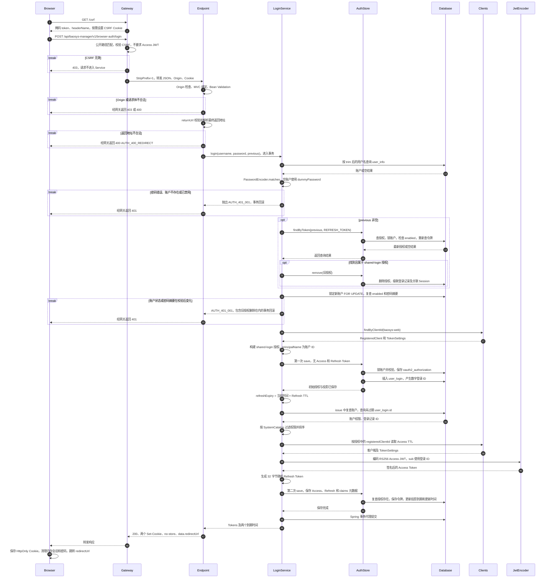
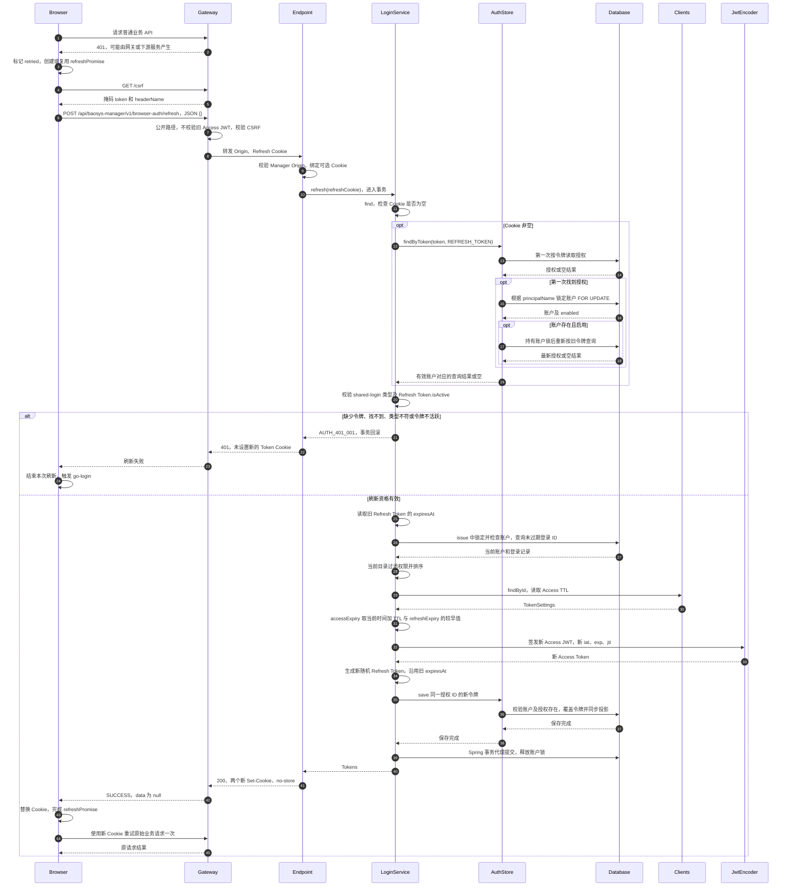
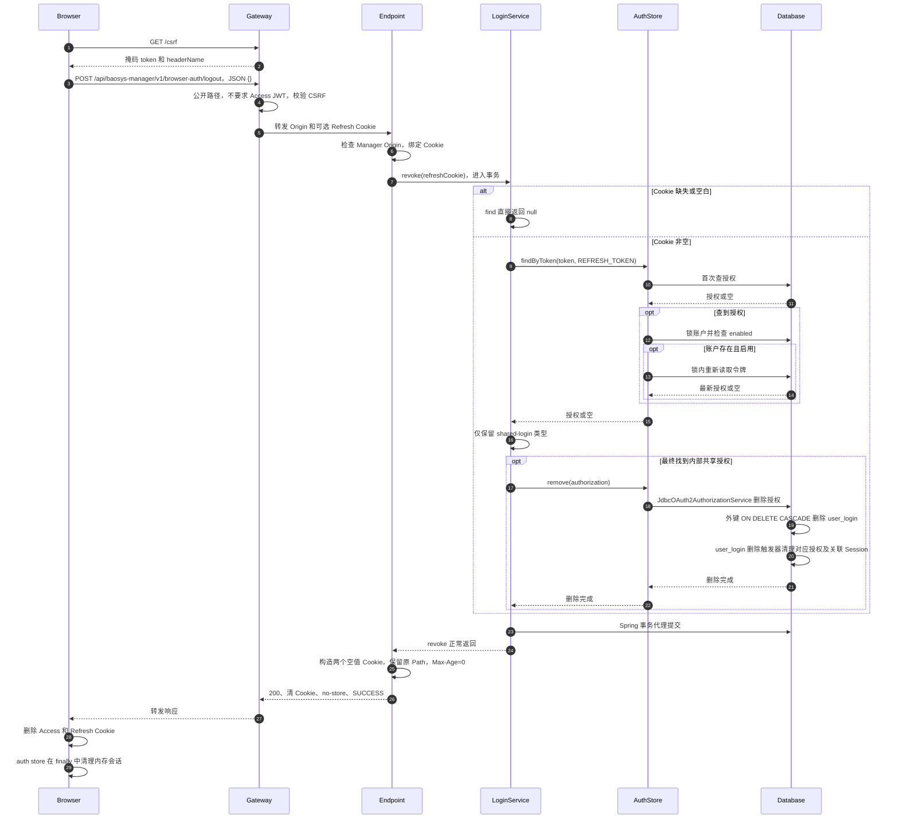

# BrowserAuthApi 接口实现时序详解

本文对应当前仓库的三个浏览器认证接口：登录、刷新和退出。每个接口各有一张 Mermaid 时序图，并说明输入、校验、事务、数据库变化、Cookie 和失败分支。

这套接口用于内部子系统的用户名密码共享登录，是 BaoSys 自定义 HTTP 契约。它复用 Spring Authorization Server 的客户端设置、授权对象和 JDBC 存储，但不经过标准 OAuth2 token 端点。OAuth2/OIDC 标准流程作为未来第三方接入能力保留，不在本文三个时序图范围内。

## 1. 阅读约定与参与组件

### 1.1 请求路径

| 层次 | 登录 | 刷新 | 退出 |
|---|---|---|---|
| 浏览器 POST 地址 | /api/baosys-manager/v1/browser-auth/login | /api/baosys-manager/v1/browser-auth/refresh | /api/baosys-manager/v1/browser-auth/logout |
| 网关 StripPrefix=1 后 | /baosys-manager/v1/browser-auth/login | /baosys-manager/v1/browser-auth/refresh | /baosys-manager/v1/browser-auth/logout |
| 去掉 Service context-path 后 | /v1/browser-auth/login | /v1/browser-auth/refresh | /v1/browser-auth/logout |

三者均声明 `consumes=application/json`。当前前端对 refresh/logout 发送 `{}`，但后端这两个方法没有 `@RequestBody` 参数，刷新凭据来自 Cookie。

### 1.2 图中参与者

| 图中名称 | 实现及职责 |
|---|---|
| Browser | Manager Vue 页面、Axios 拦截器、浏览器 Cookie 存储 |
| Gateway | Manager Web 的安全链、CsrfController、路由转发 |
| Endpoint | 为控制图宽度，合并展示 Service 的 Origin 过滤器、MVC 参数绑定与 SharedLoginController；并非新增组件 |
| LoginService | SharedLoginService，通过 Spring 事务代理进入 login/refresh/revoke |
| AuthStore | AccountAuthorizationService；内部委托 JdbcOAuth2AuthorizationService，另用 JdbcTemplate 同步登录记录 |
| Database | PostgreSQL 中 user_info、oauth2_authorization、user_login 及关联触发器 |
| Clients | RegisteredClientRepository，提供 baosys-web 客户端及 TokenSettings |
| JwtEncoder | NimbusJwtEncoder，使用外部 JWK 中的私钥签名 |

图中 Mapper 和官方 JDBC delegate 的 SQL 合并显示到 Database。没有把每一次底层 JDBC 查询、序列化调用或事务管理器调用都展开；图中的“提交/回滚”表示 Spring 事务代理行为，并非业务代码手写 commit。

### 1.3 所有接口共有的入口保护

1. 前端请求拦截器在写请求前 GET `/csrf`。网关返回掩码 token、headerName，并按需设置 XSRF-TOKEN Cookie；前端从响应正文获取 token，不直接读取 HttpOnly Cookie。
2. Axios 将 token 放进返回的 headerName 指定的请求头，浏览器自动携带适用 Cookie。
3. 网关把 `/api/baosys-manager/v1/browser-auth/**` 配置为公开路径，不要求已有 Access JWT，也不要求 MGR 入口权限。因此 Access Cookie 已过期不会阻止登录或刷新。
4. 公开不等于免 CSRF。三个 POST 仍须通过网关 CSRF 校验；为这些公开路径添加 Bearer 头也不会触发“受保护 Bearer API”豁免。
5. 路由转发后，Service 的 `SharedLoginConfiguration` 要求写请求 Origin 与 `manager-origin` 完全一致。该链为 STATELESS，关闭 Service 自身的 CSRF，校验职责分别是网关 CSRF 和 Service Origin。
6. `allowed-origins` 只允许登录后返回到指定来源，不允许那些来源直接向共享认证接口提交跨来源 POST。当前前端刷新由 Manager 页面执行。
7. 网关安全拒绝返回 403；Origin 不符时过滤器直接设置 403，不经过业务异常包装。

三个图在后端处理阶段均以这些入口校验通过为前提；明确的入口失败分支放在登录图中，刷新和退出图重复标明校验过程。

## 2. 登录：POST /login

### 2.1 契约与输入

`BrowserAuthApi.login(BrowserLoginRequest, String previous)`：

| 输入 | 来源 | 校验与用途 |
|---|---|---|
| username | JSON | @NotBlank，最多 128 字符；服务查询前 trim |
| password | JSON | @NotBlank，最多 256 字符；用于校验已有密码 |
| redirectUrl | JSON，可省略 | 最多 8192 字符，另由 returnUrl 校验目标 |
| previous | BAOSYS_REFRESH_TOKEN Cookie，可省略 | 成功登录时替换当前浏览器旧的内部共享授权 |

登录密码校验上限与“创建账户的密码长度 8～128”是不同接口的规则，不应混为一谈。

示例正文：

```json
{
  "username": "admin",
  "password": "用户输入的密码",
  "redirectUrl": "http://localhost:8080/users-management"
}
```

登录页通常从查询参数 `redirect_url` 读取目标（也兼容 `redirect`），提交 JSON 字段 `redirectUrl`。

### 2.2 登录时序图



### 2.3 为什么登录要保存两次授权

第一次 `save` 时还没有令牌：

- 创建 `oauth2_authorization`，principal_name 是账户 ID 字符串。
- AccountAuthorizationService 识别 shared-login 授权类型，插入 user_login。
- user_login.id 由数据库生成，随后才能把它放进 Access JWT 的 sub。

第二次 `save` 时已经完成签名和 Refresh Token 生成：

- 官方 JDBC 服务保存完整授权及令牌。
- 对 user_login 执行 `INSERT ... ON CONFLICT (authorization_id) DO UPDATE`。
- 已有投影只更新 expires_at 和 updated_at；不重新生成登录 ID，也不重置 created_at。

两次保存处于同一次登录事务中。如果签名、第二次保存或提交失败，初次保存也会回滚，不会正常留下一个“登录一半”的新授权。旧浏览器授权的删除也属于这个事务。

### 2.4 凭据校验、旧授权替换和返回地址

账户不存在时仍执行一次密码匹配，使用服务构造时生成的 dummyPassword，降低通过耗时区分“无此账户”和“密码错误”的风险。初次凭据检查失败不会先撤销旧浏览器授权。

凭据初验通过后先撤销 previous 对应的共享授权，再锁定新账户并重新检查启停状态和密码摘要。新旧账户可以不同。第二次检查失败时，先前删除旧授权的操作随事务回滚。

previous 为空、不匹配任何令牌、或对应外部 OAuth2 授权时，内部 revoke 不删除外部授权。登录并非“撤销这个用户所有设备”，只替换浏览器送来的旧内部授权。

`returnUrl` 在进入登录事务之前执行：

- 空目标返回 `{manager-origin}/users-management`。
- 相对地址相对于 manager-origin 解析。
- 目标须与 Manager 同主机、同协议，且 origin 是 manager-origin 或 allowed-origins 中的值。
- 拒绝用户信息、指定登录/授权/API 路径，以及检查到的换行和反斜杠编码。
- 不合法时返回 400 AUTH_400_REDIRECT，此时不会创建授权。

服务端成功响应是 200 和 JSON，不直接返回 HTTP 302；前端执行 `window.location.replace(result.redirectUrl)`。

## 3. 刷新：POST /refresh

### 3.1 契约与触发方式

`BrowserAuthApi.refresh(String refresh)` 从 BAOSYS_REFRESH_TOKEN Cookie 取值。请求体不传用户名、密码、client_id 或 refresh_token。

当前 Manager Axios 行为：

1. 普通 API 返回 401，且该请求未重试时，发起刷新。
2. 多个并发失败请求复用同一个 refreshPromise。
3. 刷新成功后，每个原始请求重试一次。
4. 刷新失败，或重试后仍为 401，触发 go-login。
5. browser-auth 接口自己的 401 不会递归刷新；403 不触发刷新。

refreshPromise 只在当前页面的 JavaScript 实例内共享，不是多个标签页或不同进程之间的互斥锁。跨请求并发正确性依靠后端账户锁及令牌复查。

### 3.2 刷新时序图



入口 CSRF/Origin 不通过时提前返回 403，不进入图中的刷新事务。issue 阶段的数据库或签名异常也会中断成功分支，具体错误边界见第 6 节。

### 3.3 刷新为什么要查两次令牌

`AccountAuthorizationService.findByToken` 的关键顺序是：

```text
第一次读取旧令牌对应授权
→ 根据授权 principalName 锁定账户
→ 检查账户仍存在且 enabled
→ 在锁内再次读取同一个旧令牌
```

假设 A、B 同时携带同一个旧 Refresh Token：

- 两个请求首次读取时，都可能找到旧授权。
- A 先拿到账户锁，轮换令牌并提交。
- B 等待后拿到锁，第二次查询旧令牌已找不到。
- B 返回业务 401，不会基于第一次读取到的过期快照再次签发。

只有等整个外层 refresh 事务结束，账户锁才释放。这里不是把 findByToken 的短事务独立提交后再签发，而是加入 SharedLoginService 已开启的事务。

服务不会因为一次旧令牌重放失败就额外撤销已经轮换成功的新授权。它的当前行为是拒绝旧令牌请求。

### 3.4 期限、身份和权限的变化

| 内容 | 刷新后的行为 |
|---|---|
| oauth2_authorization.id | 保持不变 |
| user_login.id / JWT sub | 保持不变 |
| Access JWT 字符串 | 重新签发 |
| Access JWT jti | 新 UUID |
| Refresh Token 字符串 | 重新随机生成 |
| Refresh expiresAt | 保持首次登录确定的绝对时间 |
| user_login.created_at | 保持原登录时间 |
| user_login.updated_at | 更新为授权保存时的数据库 now() |
| permissions | 从当前账户和当前内存目录重新计算 |

内部刷新无条件生成新随机 Refresh Token，并不读取 reuse-refresh-tokens 来决定是否轮换。该配置用于官方 OAuth2 流程，不是内部刷新服务的轮换开关。

## 4. 退出：POST /logout

### 4.1 契约与作用范围

`BrowserAuthApi.logout(String refresh)` 调用 `SharedLoginService.revoke(refresh)`。它不要求旧 Access JWT 仍有效，也不要求请求正文携带 token。

退出做两件相互独立但有顺序的事：

1. 在数据库事务中撤销当前 Refresh Cookie 对应的内部共享授权。
2. 事务成功返回后，Controller 设置两个 Max-Age=0 的 Token Cookie。

它不是“所有设备退出”接口，也不是外部 OAuth2/OIDC 的标准退出或撤销端点。

### 4.2 退出时序图



### 4.3 幂等与特殊情况

| 情况 | 当前行为 |
|---|---|
| Cookie 缺失或空白 | 不查库，正常返回并清 Cookie |
| Cookie 已轮换或找不到授权 | 不删除其他授权，正常返回并清 Cookie |
| 对应外部 OAuth2 授权 | 不撤销它，正常返回并清内部 Token Cookie |
| 找到内部共享授权 | 删除授权，由外键/触发器联动清理登录记录 |
| Refresh 已过期但仍能查到内部授权且账户有效 | revoke 不调用 isActive，仍可执行删除 |
| Origin/CSRF 失败 | 403，不进入撤销，不返回 Controller 的清 Cookie 头 |
| 数据库删除/提交失败 | 事务回滚，不进入正常清 Cookie 响应 |

因此不能将 revoke 简化为“过期令牌直接忽略”：它只检查 find 的结果，不像 refresh 那样检查 Token.isActive。

删除 user_login 的触发器还会尝试删除同一 authorization_id；在授权已经由 JDBC 删除的路径中，该操作不再删除额外记录。authentication_session_id 非空时，它会清理对应的 Spring Session；当前内部链为无状态，不主动新建登录 Session，常规内部登录的该值为空。

前端 auth store 在 finally 中清理内存会话，即使退出网络请求失败也会清理。但 JavaScript 不能直接删除这些 HttpOnly Cookie，所以“前端已清空用户状态”不等于“服务端撤销成功或浏览器 Cookie 已清除”。

## 5. 三个接口共用的签发、配置与 Cookie 规则

### 5.1 客户端配置如何进入 TTL

客户端标识 `JwtConstants.BROWSER_CLIENT_ID` 为 baosys-web。Service 用 `findByClientId` 找到注册客户端，读取其 TokenSettings。

当前配置：

```yaml
spring:
  security:
    oauth2:
      authorizationserver:
        client:
          baosys-web:
            registration:
              client-id: baosys-web
            token:
              access-token-time-to-live: 30m
              refresh-token-time-to-live: 30d
              reuse-refresh-tokens: false
```

Spring Boot 将 YAML 客户端配置装配到 RegisteredClientRepository。上述代码块只摘录相关字段，不是可独立启动的完整授权服务器配置。

期限计算：

```text
首次登录：
  refreshExpiry = 当前时间 + Refresh TTL（默认 30 天）

登录签发和后续刷新签发：
  accessExpiry = min(当前时间 + Access TTL, refreshExpiry)
  Access TTL 默认 30 分钟

后续刷新：
  refreshExpiry = 已存 Refresh Token.expiresAt
  不重新加 30 天
```

TTL 配置不是从 JwtConstants 读取，也不是通过登录请求传入。后续刷新读取当前客户端的 Access TTL，但已有会话的 Refresh 绝对期限保持原值。

### 5.2 issue 的共同步骤

登录和刷新都调用私有 issue 方法，且都已处于外层事务内：

1. 通过授权 principalName 解析账户 ID，加行锁并检查 enabled。
2. 查询 authorization_id 对应且 expires_at > now() 的 user_login.id。
3. 解码 user_permissions，通过 SystemCatalog.effectiveGrants 过滤目录中无效的授权，再去重排序。
4. 读取 RegisteredClient 的 Access TTL，计算不晚于 refreshExpiry 的 Access 到期时间。
5. 生成 JWT claims 并交给 JwtEncoder 签名。
6. 用 SecureRandom 生成 32 字节随机值，经 Base64 URL-safe 无 padding 编码生成不透明 Refresh Token。
7. 保存完整授权和 claims 元数据，同步登录投影。
8. 返回内部 Tokens record。该 record 只在 Service/Controller 之间使用，不是浏览器响应 DTO。

### 5.3 JWT 与授权身份不是同一个 ID

| 字段 | 含义 |
|---|---|
| OAuth2Authorization.principalName | user_info.id 的字符串 |
| OAuth2Authorization.id | 官方授权记录 ID |
| user_login.authorization_id | 指向官方授权记录 |
| JWT sub | user_login.id 的字符串 |
| JWT client_id | baosys-web |
| JWT permissions | 当前有效系统入口及接口权限列表 |
| JWT iss / aud | 配置的 issuer / def |
| JWT iat / exp / jti | 签发时间 / 到期时间 / 新 UUID |

签名头使用 RS256、at+jwt，kid 来自签名 JWK。内部 JWT 不写 scope、system_type 或 systemType。Refresh Token 不是 JWT，不包含这些业务 claims。

### 5.4 Cookie 与响应

| 项目 | Access Cookie | Refresh Cookie |
|---|---|---|
| 名称 | BAOSYS_ACCESS_TOKEN | BAOSYS_REFRESH_TOKEN |
| Path | / | /api/baosys-manager/v1/browser-auth |
| HttpOnly | true | true |
| SameSite | Lax | Lax |
| Secure | 由 secure-cookie 配置 | 由 secure-cookie 配置 |
| Domain | 不设置 | 不设置 |
| 登录/刷新 Max-Age | 当前时刻到 accessExpiry 的剩余时间 | 当前时刻到 refreshExpiry 的剩余时间 |
| 退出 | 空值、Max-Age=0，Path 保持不变 | 空值、Max-Age=0，Path 保持不变 |

剩余时间为负时按零处理。没有 Domain 时按设置它的主机保存，Cookie 不区分端口，因此能在同一主机的不同端口共享；不等于跨子域共享。HTTPS manager-origin 要求 secure-cookie=true。

登录成功的业务数据为：

```json
{
  "code": "SUCCESS",
  "data": {
    "redirectUrl": "http://localhost:8080/users-management"
  }
}
```

刷新和退出成功的业务数据为：

```json
{
  "code": "SUCCESS",
  "data": null
}
```

示例省略 ApiResponse 的 message、traceId、timestamp。三类正常响应都使用 Cache-Control: no-store；令牌仅通过 Set-Cookie 返回，不进入 data。

## 6. 失败分支与一致性边界

### 6.1 错误处理位置

| 失败位置 | 典型条件 | 响应/处理 |
|---|---|---|
| 网关安全链 | CSRF 缺失或无效 | 403，不保证 ApiResponse |
| Service Origin 过滤器 | Origin 缺失或与 manager-origin 不一致 | 直接 403，无业务包装 |
| MVC 请求体解析/校验 | 登录 JSON 错误、必填字段缺失或超长 | 400 AUTH_400_001 |
| MVC 媒体类型匹配 | 不符合 application/json | 在进入 Controller 前失败，不能按正常登录业务分支处理 |
| returnUrl | 不允许的跳转目标 | 400 AUTH_400_REDIRECT |
| SharedLoginService 明确业务拒绝 | 凭据错误、账号失效、无有效刷新凭据 | 401 AUTH_401_001 |
| AccountAuthorizationService 防御检查 | 带 Access Token 保存时授权已不存在等 | 抛出 OAuth2AuthenticationException，交给安全异常流程，不保证业务 JSON |
| 数据库查询/签名/提交 | 查询缺失、数据库错误、签名失败 | 中断事务；未特殊处理的异常进入 SYS_500_001 等统一异常流程 |

需要特别注意：issue 使用 queryForObject 查询未过期 user_login。没有匹配行时会产生数据访问异常，当前代码没有在该处显式转换为 AUTH_401_001。因此图中的“刷新资格合法”不保证后续所有失败都统一为 401。

登录找不到 baosys-web 客户端时的 requireNonNull、签发时缺失注册配置等，也不是用户名密码错误，而是配置/运行异常。文档不把这些情况描述为已实现的业务认证错误。

### 6.2 事务与 HTTP 不能视为一个原子操作

- login、refresh、revoke 的 @Transactional 入口由 Controller 经 Spring Bean 代理调用。
- login 内部直接调用 revoke、issue 不新开事务；它们运行在已有登录事务中。
- AuthStore 的事务方法默认加入外层事务，账户行锁持续到外层事务结束。
- Controller 在服务正常返回后才构造 Set-Cookie，数据库事务此时已经提交。
- 若数据库已提交但 HTTP 响应丢失，不能自动回滚数据库。刷新响应丢失时，浏览器仍持有旧令牌，再次使用可能得到 401；登录响应丢失也可能留下已创建的授权。
- 退出提交成功但响应丢失时，浏览器 Cookie 可能仍在，但对应刷新授权已经不存在。

### 6.3 撤销不等于所有 JWT 立即失效

退出、账户变更、踢下线和清理登录记录都会影响服务端授权；相关 Refresh Token 不能再正常刷新。

已经签发的 Access JWT 若由其他服务离线验签，仍可能有效到 exp。依赖 user_login 的当前用户查询会随登录记录删除失效。jti 不是撤销黑名单，也不意味着防重放。

空闲清理根据 user_login.updated_at 是否超过一天判断。刷新/保存授权更新该时间，普通业务 API 访问不会自动更新；因此“Refresh TTL 为 30 天”不等于任何会话都保证保留 30 天。

## 7. 源码索引与现有验证

| 内容 | 源码 |
|---|---|
| API 契约 | [BrowserAuthApi.java](../../../baosys-manager/baosys-manager-api/src/main/java/baosys/manager/api/BrowserAuthApi.java) |
| 登录请求 | [BrowserLoginRequest.java](../../../baosys-manager/baosys-manager-api/src/main/java/baosys/manager/api/dto/BrowserLoginRequest.java) |
| 登录响应 | [BrowserLoginResponse.java](../../../baosys-manager/baosys-manager-api/src/main/java/baosys/manager/api/dto/BrowserLoginResponse.java) |
| Controller 与 Cookie | [SharedLoginController.java](../../../baosys-manager/baosys-manager-service/src/main/java/baosys/manager/app/controllers/SharedLoginController.java) |
| 登录/刷新/撤销与签发 | [SharedLoginService.java](../../../baosys-manager/baosys-manager-service/src/main/java/baosys/manager/infra/security/SharedLoginService.java) |
| 授权 JDBC 与投影 | [AccountAuthorizationService.java](../../../baosys-manager/baosys-manager-service/src/main/java/baosys/manager/infra/security/AccountAuthorizationService.java) |
| Service 安全链 | [SharedLoginConfiguration.java](../../../baosys-manager/baosys-manager-service/src/main/java/baosys/manager/infra/security/SharedLoginConfiguration.java) |
| 返回地址检查 | [SharedLoginProperties.java](../../../baosys-manager/baosys-manager-service/src/main/java/baosys/manager/infra/security/SharedLoginProperties.java) |
| 网关安全链 | [GatewaySecurityConfig.java](../../../baosys-common-security-gateway/src/main/java/baosys/common/security/gateway/GatewaySecurityConfig.java) |
| CSRF 端点 | [CsrfController.java](../../../baosys-common-security-gateway/src/main/java/baosys/common/security/gateway/CsrfController.java) |
| 账户、授权和触发器 | [V1__init_manager.sql](../../../baosys-manager/baosys-manager-service/src/main/resources/db/migration/V1__init_manager.sql) |
| TTL 与共享登录配置 | [application.yml](../../../baosys-manager/baosys-manager-service/src/main/resources/application.yml) |
| Axios CSRF/刷新逻辑 | [request.ts](../../../baosys-manager-ui/src/utils/request.ts) |
| 登录跳转逻辑 | [LoginView.vue](../../../baosys-manager-ui/src/views/login/LoginView.vue) |
| 前端会话清理 | [auth.ts](../../../baosys-manager-ui/src/store/auth.ts) |

现有验证入口：

- [SharedLoginControllerTest](../../../baosys-manager/baosys-manager-service/src/test/java/baosys/manager/app/controllers/SharedLoginControllerTest.java)：接口注解继承、请求体校验、Cookie 参数绑定、响应及清 Cookie。
- [SharedLoginIntegrationTest](../../../baosys-manager/baosys-manager-service/src/test/java/baosys/manager/app/controllers/SharedLoginIntegrationTest.java)：登录、刷新轮换、退出撤销、旧授权替换、错误凭据/Origin/返回地址及切换账户。
- [GatewaySecurityIntegrationTest](../../../baosys-manager-web/src/test/java/baosys/managerweb/security/GatewaySecurityIntegrationTest.java)：网关侧认证与安全行为。

图根据当前实现整理，测试覆盖说明不代表每一种网络丢包、并发时序或异常分支都有独立测试。本次新增文档不修改认证实现。

相关设计：[认证与会话](auth_and_session.md)、[权限模型](permission_model.md)、[数据库设计](database_design.md)、[Manager 模块设计](manager_module_design.md)。
