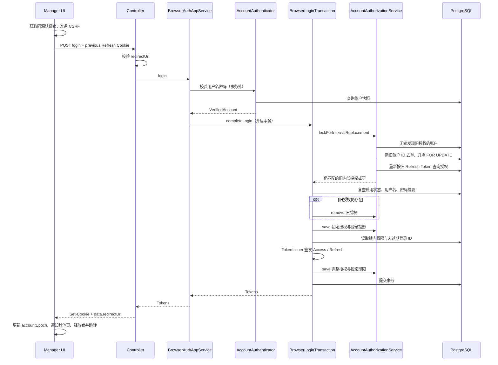
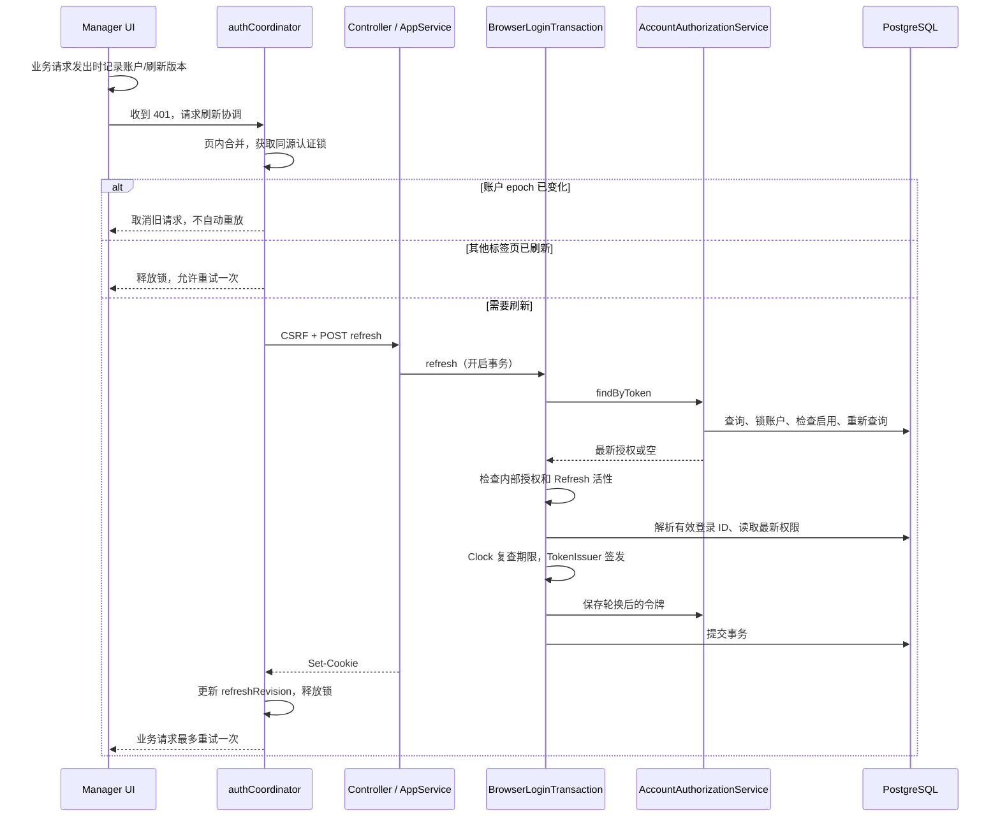
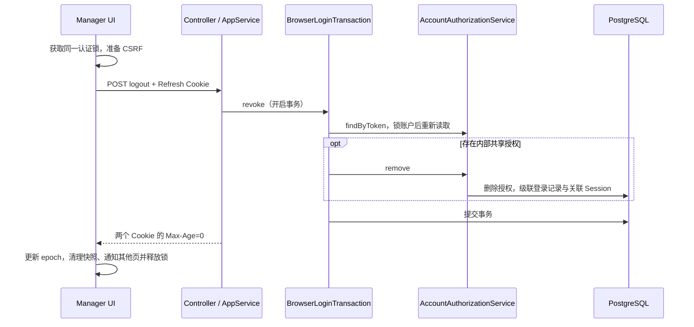

# BrowserAuthApi 接口实现时序

**简体中文** | [English](browser_auth_sequence.en.md)

内部系统通过用户名密码登录，OAuth 授权码流程按需复用同一登录页和内部身份。PKCE 按客户端配置，不全局强制。本文描述当前实现。

## 1. 参与组件与入口保护

| 组件 | 职责 |
|---|---|
| authCoordinator / request.ts | 同源标签页认证锁、版本标记、CSRF 和请求重试 |
| Gateway | CSRF、入口权限、Cookie 到 Bearer 转发 |
| SharedLoginController | 返回地址校验、Cookie 和响应适配 |
| BrowserAuthAppService | 应用入口，密码认证与事务组件编排，认证失败转业务 401 |
| AccountAuthenticator | 事务外密码校验，返回内部认证快照 |
| BrowserLoginTransaction | 登录完成、刷新与退出的独立 Spring 事务入口 |
| AccountAuthorizationService | 框架 JDBC 授权适配、账户锁、登录投影协调 |
| AccountTokenSubjectResolver / TokenIssuer | 最新权限与主体解析 / 公共令牌签发 |
| UserInfoMapper / UserLoginMapper | 账户与登录投影持久化 |

浏览器入口为 `/api/baosys-manager/v1/browser-auth/{login,refresh,logout}`。网关移除 `/api`，Service context-path 默认 `/baosys-manager`，Controller 匹配 `/v1/browser-auth/**`。

三个端点公开但不豁免浏览器 CSRF。UI 写请求先获取 `/api/baosys-manager/csrf`，将 token 放入指定请求头。网关校验 CSRF；Service 另外要求写请求 Origin 与 manager-origin 精确匹配。已有 Access JWT 失效不阻止认证请求。三者均使用 JSON；刷新和退出凭据来自 HttpOnly Refresh Cookie。

## 2. 登录

请求包含 username、password 和可选 redirectUrl。Controller 在认证前检查返回地址，普通目标使用来源白名单；恢复 OAuth 请求只允许配置中的授权端点，拒绝其他来源、路径、用户信息和片段。

密码错误、账户不存在或禁用统一返回 AUTH_401_001；不存在账户也执行 dummy 密码校验。认证快照含密码摘要，仅在服务端传递，toString 隐去内容，不进入响应或日志。

旧令牌首次读取只用于发现待锁账户，不用于最终授权判断。最终结果若属于未锁账户则拒绝，不能追加乱序锁。已轮换/删除的旧令牌跳过；外部 OAuth 授权不作为内部替换目标。

最终凭据复查失败不会撤销旧授权；签发、保存或提交失败时整个替换事务回滚。事务开始后不再次执行 BCrypt，而是核对摘要是否变化。新令牌使用锁内最新权限。

## 3. 刷新

内部采用绝对期限：首次登录决定 Refresh 到期时间，后续轮换不延长它；Access 到期时间为 `min(now + Access TTL, refreshExpiry)`。

旧 Refresh Token 轮换后不可再次使用。无效刷新、投影不存在/过期或签发前已到期限返回业务 401；数据库、签名或配置故障保留系统错误语义。

认证传输继续获取 CSRF，但不进入业务 401 拦截器，避免递归刷新或锁重入。共享锁等待上限为 15 秒，认证 HTTP 请求超时 10 秒。明确刷新 401 才通知登录失效；网络错误、5xx 和等待超时保留登录状态并返回错误。

跨页存储只含 accountEpoch、refreshRevision、lastOperation，不含令牌或权限。BroadcastChannel、storage 和 focus 通知用于清空旧快照，锁内读取存储用于判断刷新是否完成。账户变化后不重放旧请求，也拒绝迟到成功响应。

无 Web Locks 或存储不可用时只保证页内协调。不同端口虽共享 Cookie，但不共享锁；其他子系统继续跳转 Manager 管理认证。带副作用请求的自动重试要求 401 来自业务执行前的认证拒绝，不能以此保证业务幂等。

## 4. 退出

缺失或找不到内部授权时退出仍成功；此入口不撤销外部 OAuth 授权。数据库或网络失败时不广播退出成功，前端保留状态供重试。JavaScript 不能直接删除 HttpOnly Cookie。

## 5. Cookie、期限和清理

| Cookie | Path | 属性 |
|---|---|---|
| BAOSYS_ACCESS_TOKEN | `/` | HttpOnly、SameSite=Lax、按配置 Secure |
| BAOSYS_REFRESH_TOKEN | `/api/baosys-manager/v1/browser-auth` | 同上 |

Cookie 不设置 Domain；HTTPS manager-origin 必须启用 secure-cookie。成功响应使用 Cache-Control: no-store，令牌不进入 JSON。Access Token sub 为 user_login.id；OAuth principalName 和 OIDC ID Token sub 为账户 ID。

清理只检查 expires_at，不以 updated_at 或一天未访问作为撤销依据。函数每次处理最多 100 个账户，按 ID 升序锁账户、跳过忙碌账户、锁内复查并删除已过期登录；建议每五分钟调度一次。管理员下线操作同样先锁账户，请求时的过期检查不依赖调度执行。

OAuth 授权有 Refresh Token 时投影取其到期时间；未兑换授权取授权码期限；无 Refresh Token 的已兑换授权取 Access/ID Token 中较晚期限，以保留仍有效 ID Token 的相关授权信息。

## 6. 原子性与验证边界

- 应用服务经另一个 Spring Bean 调用事务方法，避免自调用绕开代理；存储方法加入外层事务。
- Controller 在事务正常提交后设置 Cookie；数据库与 HTTP 仍不是一个原子操作。
- 刷新已提交但响应丢失时，浏览器可能仍持旧令牌，需要重新登录；当前没有旧令牌宽限窗口。
- 撤销阻止刷新和需要查询会话的操作；仅离线验签的业务接口仍可能接受旧 JWT 直到到期。
- 数据库测试覆盖双向切换、凭据变化、替换回滚、清理与锁跳过；浏览器测试用真实多页面和 Cookie 验证协调，HTTP 服务为测试替身，不是整套部署的端到端测试。

## 7. 源码与测试

- [BrowserAuthAppService](../../../baosys-manager/baosys-manager-service/src/main/java/baosys/manager/app/services/BrowserAuthAppService.java)
- [BrowserLoginTransaction](../../../baosys-manager/baosys-manager-service/src/main/java/baosys/manager/app/services/impl/BrowserLoginTransaction.java)
- [AccountAuthorizationService](../../../baosys-manager/baosys-manager-service/src/main/java/baosys/manager/infra/security/AccountAuthorizationService.java)
- [authCoordinator](../../../baosys-manager-ui/src/utils/authCoordinator.ts)
- [浏览器协调测试](../../../baosys-manager-ui/tests/auth-coordination.spec.js)
- [数据库生命周期测试](../../../baosys-manager/baosys-manager-service/src/test/java/baosys/manager/app/services/impl/BrowserAuthLifecycleIntegrationTest.java)
- [测试与部署命令](../../development.md)
