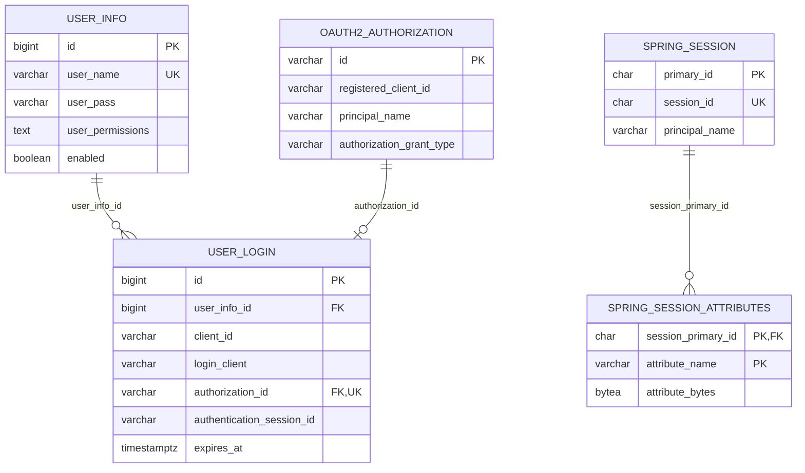

# Manager database design

[简体中文](database_design.md) | **English**

The current schema is defined by [V1__init_manager.sql](../../../baosys-manager/baosys-manager-service/src/main/resources/db/migration/V1__init_manager.sql). This is the repository's sole initialization migration and includes accounts, OAuth2, Spring Session, auditing, and revocation triggers. There are no V2/V3/V4 upgrade scripts.

## 1. Schema and tables

The database is PostgreSQL with default schema `manager`. MANAGER_DB_SCHEMA configures both Hikari and Flyway. Flyway creates the schema and uses history table `flyway_schema_history_manager`; baseline-on-migrate is not configured. Spring Session uses initialize-schema=never because Flyway creates its tables.

| Table | Purpose |
|---|---|
| user_info | Accounts, BCrypt passwords, permissions, enabled state |
| user_login | Login projection linking accounts to framework authorizations |
| permission_change_audit | Account authorization and enabled-state change audits |
| oauth2_authorization | OAuth2/shared-login authorizations and tokens |
| oauth2_authorization_consent | Framework consent records |
| spring_session | Authorization-server login sessions |
| spring_session_attributes | Session attributes |

V1 initializes an empty database; compatibility with an arbitrary old schema must not be assumed. Future schema changes to deployed databases require new migrations and separate verification.

## 2. Main relationships



`user_login.authentication_session_id` is a nullable logical association, not a foreign key. `oauth2_authorization.principal_name` stores the account ID as a string and also has no account foreign key; application logic and triggers maintain its lifecycle. Audit tables omit user foreign keys so history survives account deletion.

## 3. user_info

| Column | Type and constraints | Meaning |
|---|---|---|
| id | BIGINT IDENTITY, primary key | Account ID |
| user_name | VARCHAR(128), NOT NULL, UNIQUE | Globally unique username |
| user_pass | VARCHAR(512), NOT NULL | BCrypt password hash |
| user_permissions | TEXT, NOT NULL | Sorted comma-separated permissions; an empty set is an empty string |
| enabled | BOOLEAN, NOT NULL, DEFAULT TRUE | Whether login and refresh are allowed |
| created_at / updated_at | TIMESTAMPTZ, NOT NULL | Creation/update time |
| created_by / updated_by | VARCHAR(128), NOT NULL | Basic audit markers |

The uniqueness constraint is `uk_user_info_user_name(user_name)`. The application trims usernames before writing; the current ordinary VARCHAR unique constraint is case-sensitive. There is no system_type column; accounts with the same name cannot be created separately per system.

Permission writes first undergo strict SystemCatalog validation, then PermissionPersistenceConverter sorts and joins them with commas. Reads split on commas, trim, remove empty entries, and deduplicate. Valid example:

```text
CAT,MGR,MGR:user:add,MGR:user:list
```

Neither the database nor application currently checks a total permission-character limit. See the [Permission model](permission_model.en.md) for catalog and naming conventions.

## 4. user_login

| Column | Type and constraints | Meaning |
|---|---|---|
| id | BIGINT IDENTITY, primary key | Access JWT sub |
| user_info_id | BIGINT, NOT NULL, FK | Owning account |
| client_id | VARCHAR(128), NOT NULL | Registered client identifier, unrelated to authorized systems |
| login_client | VARCHAR(512), NOT NULL | User-Agent, defaults to OAuth2 if missing, truncated to 512 characters |
| authorization_id | VARCHAR(100), NOT NULL, UNIQUE, FK | oauth2_authorization.id |
| authentication_session_id | VARCHAR(36), nullable | Authorization-server Session ID |
| expires_at | TIMESTAMPTZ, NOT NULL | Current refresh-session expiry |
| created_at / updated_at | TIMESTAMPTZ, NOT NULL | Creation/most recent authorization-save time |
| created_by / updated_by | VARCHAR(128), NOT NULL | Current adapter writes oauth2 |

Both foreign keys use ON DELETE CASCADE. Deleting an account deletes login records; deleting authorization deletes its login record. Authorization ID uniqueness ensures at most one login projection per authorization.

Indexes include `idx_user_login_user_info_id(user_info_id)` and `idx_user_login_expires_at(expires_at)`, plus primary/unique constraint indexes.

AccountAuthorizationService uses JdbcTemplate to insert or update projections by authorization_id. Conflict updates synchronize only expires_at and updated_at. This path does not use the MyBatis basic audit filler.

Internal shared refresh retains the original absolute login expiry. With external OAuth2's current reuse-refresh-tokens=false setting, rotation may give a new token a new lifetime, and the projection synchronizes the new expiry. Not all sessions have fixed absolute lifetimes.

## 5. Framework authorization and Session tables

`oauth2_authorization` follows Spring Authorization Server's JDBC field structure with PostgreSQL TEXT/TIMESTAMPTZ variants. It stores grant type, registered client ID, principal, attributes, authorization codes, Access/Refresh/ID Tokens, their timestamps, and metadata. Primary key id is VARCHAR(100), with an additional `idx_oauth2_authorization_principal(principal_name)` index.

`oauth2_authorization_consent` uses composite primary key (registered_client_id, principal_name), with authorities holding consent content. The default client does not require user consent, but the JDBC consent service and table are configured.

RegisteredClient entries come from application configuration; there is no oauth2_registered_client table. Persisted registered_client_id values depend on stable configuration record IDs.

`spring_session` uses primary_id as its primary key, unique session_id, and indexes on expiry_time and principal_name. Time columns use BIGINT. `spring_session_attributes` uses composite primary key (session_primary_id, attribute_name) and cascades on Session deletion.

The framework JDBC service handles token serialization; user_login has no refresh-hash column. The authorization table contains raw tokens, so database access and backups must be protected.

## 6. Revocation triggers and cleanup

| Trigger/function | Behavior |
|---|---|
| revoke_login_authorization | After user_login deletion, deletes the matching authorization and Session identified by authentication_session_id |
| revoke_changed_account_authorizations | After user_info deletion or username/password/enabled/permission changes, deletes all authorizations and sessions for the account ID |
| cleanup_inactive_user_login_sessions() | Deletes only expired expires_at records; locks at most 100 accounts in ascending ID order, skips busy accounts with SKIP LOCKED, rechecks under lock, deletes, and returns the count |

Authorization deletion cascades to the projection; projection deletion cleans up its authorization and Session. Revocation from either entry propagates across related records. Audit records are outside the cascade.

Flyway creates the cleanup function but starts no scheduled job. The [pg_cron example](../../../baosys-manager/baosys-manager-service/src/main/resources/db/scheduler/pg_cron_user_login_cleanup.sql) can register daily cleanup; other schedulers may call the same function. Ordinary API access does not update user_login.updated_at; refresh/authorization saves do.

## 7. Queries and online status

| Query | Current conditions and ordering |
|---|---|
| Login account | Exact user_name match |
| User pagination | Trim nonempty name before LIKE; exact systemType membership with ANY(string_to_array(user_permissions, ',')); id ASC |
| Session pagination | expires_at > current time; exact userId takes precedence, otherwise userName uses LOWER + LIKE; created_at DESC |
| User login clients | Specified user_info_id and unexpired; created_at DESC |
| Revoke a client | Match loginId and userId, with an unexpired record |

External pages are zero-based; mappers use page + 1 for MyBatis Plus. User pagination retrieves all online account IDs for the current page in one query, avoiding N+1 queries.

UserResponse.status means an unexpired login record exists; enabled controls account activation. “Online” is not a real-time connection probe. An unexpired record may also not yet have been processed by cleanup. Refresh separately validates the token, enabled account, authorization, and login state.

## 8. Auditing and Java mappings

| Data/capability | Implementation |
|---|---|
| Account | UserInfoEntity / UserInfoMapper |
| Login projection | UserLoginEntity / UserLoginMapper |
| Joined session query | LoginSessionRow |
| Authorization audit | PermissionChangeAuditEntity / PermissionChangeAuditMapper |
| Permission encoding | PermissionPersistenceConverter |
| OAuth2 authorization projection maintenance | AccountAuthorizationService + JdbcTemplate |

MyBatis Plus enables underscore-to-camel-case mapping. `MybatisPlusAuditHandler` fills createdAt/updatedAt and createdBy/updatedBy, defaulting the operator marker to system. Business audits separately store the real operator_user_id. Application time mainly uses UTC OffsetDateTime; authorization projection SQL uses database now(); business time columns are TIMESTAMPTZ.

All permission_change_audit columns are NOT NULL:

| Column | Type |
|---|---|
| id | BIGINT IDENTITY primary key |
| operator_user_id / target_user_id | BIGINT |
| before_permissions / after_permissions | TEXT |
| before_enabled / after_enabled | BOOLEAN |
| trace_id | VARCHAR(128) |
| occurred_at | TIMESTAMPTZ |

Its index is `idx_permission_change_audit_target_occurred(target_user_id, occurred_at DESC)`. Creation, deletion, and permission/enabled-state changes are audited. Default administrator creation also writes an audit with trace_id bootstrap-default-admin. Username/password-only changes do not create permission-change audits.

## 9. Migrations and verification

Subsequent migrations use `V{version}__{description}.sql`. Do not rewrite deployed versions in place. New columns need explicit decisions about defaults, nullability, and existing data.

Database tests include ManagerInitializationIntegrationTest, UserLoginCleanupFunctionIntegrationTest, and AccountLifecycleIntegrationTest, covering initialization/constraints, cleanup, and authorization lifecycles. The base class uses Testcontainers with postgres:17-alpine. See [Module design](manager_module_design.en.md) for commands.

Login record updated_at marks record modification, not an idle deadline. Internal Refresh Tokens retain their initial absolute lifetime, matched by login record expires_at. OAuth authorizations use Refresh expiry when available, authorization-code expiry before redemption, and the later Access/ID Token expiry for final authorizations without Refresh Tokens. Ordinary API requests do not write activity heartbeats.
