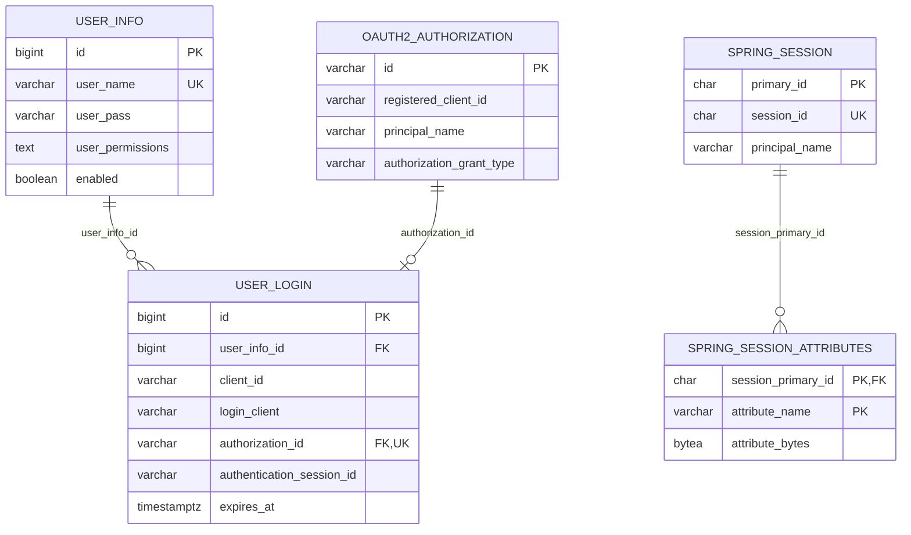

# Manager 数据库设计

当前数据库结构以 [V1__init_manager.sql](../../../baosys-manager/baosys-manager-service/src/main/resources/db/migration/V1__init_manager.sql) 为准。仓库只有这一个初始化迁移，已包含账户、OAuth2、Spring Session、审计和撤销触发器；没有 V2/V3/V4 升级脚本。

## 1. Schema 和表范围

使用 PostgreSQL，默认 schema 为 `manager`，由 MANAGER_DB_SCHEMA 同时配置 Hikari 与 Flyway。Flyway 创建 schema，历史表名为 `flyway_schema_history_manager`；没有配置 baseline-on-migrate。Spring Session 配置 initialize-schema=never，其表由 Flyway 创建。

| 表 | 用途 |
|---|---|
| user_info | 账户、BCrypt 密码、权限和启停 |
| user_login | 账户与官方授权的登录投影 |
| permission_change_audit | 账户授权及启停变更审计 |
| oauth2_authorization | OAuth2/共享登录授权及令牌 |
| oauth2_authorization_consent | 官方授权确认记录 |
| spring_session | 认证中心登录 Session |
| spring_session_attributes | Session 属性 |

V1 面向空库初始化，不能直接推断它兼容任何旧版 schema。后续已部署数据库的结构调整需要新增迁移并单独验证。

## 2. 主要关系



`user_login.authentication_session_id` 是可空的逻辑关联，不是外键。`oauth2_authorization.principal_name` 保存账户 ID 字符串，也没有账户外键；生命周期由应用与触发器维护。审计表不设置用户外键，以便删除账户后仍保留历史。

## 3. user_info

| 字段 | 类型与约束 | 含义 |
|---|---|---|
| id | BIGINT IDENTITY，主键 | 账户 ID |
| user_name | VARCHAR(128)，NOT NULL，UNIQUE | 全局唯一用户名 |
| user_pass | VARCHAR(512)，NOT NULL | BCrypt 密码摘要 |
| user_permissions | TEXT，NOT NULL | 排序后的逗号分隔权限；空集合存空字符串 |
| enabled | BOOLEAN，NOT NULL，DEFAULT TRUE | 是否允许登录和刷新 |
| created_at / updated_at | TIMESTAMPTZ，NOT NULL | 创建/更新时间 |
| created_by / updated_by | VARCHAR(128)，NOT NULL | 基础审计标记 |

唯一约束为 `uk_user_info_user_name(user_name)`。应用写入前 trim 用户名，数据库按当前普通 VARCHAR 唯一约束区分大小写。没有 system_type 字段；同名账户不能按系统分别创建。

权限写入先经过 SystemCatalog 严格校验，再由 PermissionPersistenceConverter 排序、逗号连接。读取时按逗号拆分、trim、去空和去重。合法示例：

```text
CAT,MGR,MGR:user:add,MGR:user:list
```

当前没有数据库或应用层的权限总字符数上限检查。目录和编码约定见 [权限模型](permission_model.md)。

## 4. user_login

| 字段 | 类型与约束 | 含义 |
|---|---|---|
| id | BIGINT IDENTITY，主键 | Access JWT 的 sub |
| user_info_id | BIGINT，NOT NULL，FK | 所属账户 |
| client_id | VARCHAR(128)，NOT NULL | 注册客户端标识，与授权系统无关 |
| login_client | VARCHAR(512)，NOT NULL | User-Agent，缺失时为 OAuth2，最多截取 512 字符 |
| authorization_id | VARCHAR(100)，NOT NULL，UNIQUE，FK | oauth2_authorization.id |
| authentication_session_id | VARCHAR(36)，可空 | 认证中心 Session ID |
| expires_at | TIMESTAMPTZ，NOT NULL | 当前刷新会话到期时间 |
| created_at / updated_at | TIMESTAMPTZ，NOT NULL | 创建/最近保存授权的时间 |
| created_by / updated_by | VARCHAR(128)，NOT NULL | 当前适配器写入 oauth2 |

两个外键都使用 ON DELETE CASCADE：账户删除会删除登录记录，授权删除也会删除对应登录记录。授权 ID 唯一，保证每个授权最多对应一条登录投影。

索引为 `idx_user_login_user_info_id(user_info_id)`、`idx_user_login_expires_at(expires_at)`，以及主键/唯一约束对应索引。

AccountAuthorizationService 使用 JdbcTemplate 插入或按 authorization_id 更新投影；冲突更新只同步 expires_at 和 updated_at。此路径不经过 MyBatis 基础审计填充器。

内部共享刷新保留首次登录的绝对到期时间；外部 OAuth2 在当前 reuse-refresh-tokens=false 配置下轮换时，新令牌可获得新的有效期，投影同步新到期时间。不能把所有会话都描述为固定绝对期限。

## 5. 官方授权和 Session 表

`oauth2_authorization` 采用 Spring Authorization Server JDBC 字段结构，使用 PostgreSQL TEXT/TIMESTAMPTZ 类型变体。它保存授权类型、注册客户端 ID、主体、属性、授权码、Access/Refresh/ID Token 及其时间和元数据等。主键 id 为 VARCHAR(100)，另有 `idx_oauth2_authorization_principal(principal_name)` 索引。

`oauth2_authorization_consent` 以 (registered_client_id, principal_name) 为复合主键，authorities 保存授权确认内容。默认客户端不要求用户确认，但 JDBC consent 服务和表已配置。

RegisteredClient 来源是应用配置，不存在 oauth2_registered_client 表。数据库授权中的 registered_client_id 依赖稳定的配置记录 ID。

`spring_session` 以 primary_id 为主键，session_id 唯一，另有 expiry_time、principal_name 索引。时间字段使用 BIGINT；`spring_session_attributes` 以 (session_primary_id, attribute_name) 为复合主键，并级联跟随 Session 删除。

令牌序列化由官方 JDBC 服务处理；user_login 没有刷新摘要列。授权表包含令牌原文，数据库访问和备份应受保护。

## 6. 撤销触发器与空闲清理

| 触发器/函数 | 行为 |
|---|---|
| revoke_login_authorization | user_login 删除后，删除对应授权及 authentication_session_id 对应的 Session |
| revoke_changed_account_authorizations | user_info 删除，或用户名/密码/enabled/权限变化后，按账户 ID 删除全部授权和 Session |
| cleanup_inactive_user_login_sessions() | 删除 updated_at 早于 CURRENT_TIMESTAMP - INTERVAL '1 day' 的登录记录，返回删除数量 |

授权删除通过外键删除投影，投影删除又清理关联授权和 Session，从任一入口撤销都能联动。审计记录不在级联删除范围内。

Flyway 只创建空闲清理函数，不启动定时任务。[pg_cron 示例](../../../baosys-manager/baosys-manager-service/src/main/resources/db/scheduler/pg_cron_user_login_cleanup.sql) 可注册每日清理，其他调度器也可调用同一函数。普通 API 访问不更新 user_login.updated_at，刷新/保存授权才更新。

## 7. 查询与在线状态

| 查询 | 当前条件及排序 |
|---|---|
| 登录账户 | user_name 精确匹配 |
| 用户分页 | name 非空时 trim 后 LIKE；systemType 使用 ANY(string_to_array(user_permissions, ',')) 精确匹配；id ASC |
| 会话分页 | expires_at > 当前时间；userId 精确条件优先，否则 userName 使用 LOWER + LIKE；created_at DESC |
| 用户登录客户端 | 指定 user_info_id 且未过期；created_at DESC |
| 指定客户端下线 | 同时匹配 loginId、userId，且记录尚未过期 |

外部页码从 0 开始，Mapper 使用 page + 1 转换到 MyBatis Plus。用户分页一次查询当前页全部在线账户 ID，避免 N+1。

UserResponse.status 表示是否存在未过期登录记录，enabled 才是账号启停。“在线”不是实时连接探测；未过期记录也可能尚未被空闲清理。刷新另需验证有效令牌、启用账户和授权/登录状态。

## 8. 审计和 Java 映射

| 数据/能力 | 实现 |
|---|---|
| 账户 | UserInfoEntity / UserInfoMapper |
| 登录投影 | UserLoginEntity / UserLoginMapper |
| 联表会话查询 | LoginSessionRow |
| 授权审计 | PermissionChangeAuditEntity / PermissionChangeAuditMapper |
| 权限编码 | PermissionPersistenceConverter |
| OAuth2 授权投影维护 | AccountAuthorizationService + JdbcTemplate |

MyBatis Plus 开启下划线转驼峰。`MybatisPlusAuditHandler` 填充 createdAt/updatedAt 和 createdBy/updatedBy，默认操作者标记为 system；业务审计另行记录真实 operator_user_id。应用时间主要使用 UTC OffsetDateTime，授权投影 SQL 使用数据库 now()，业务时间列为 TIMESTAMPTZ。

permission_change_audit 所有字段均 NOT NULL：

| 字段 | 类型 |
|---|---|
| id | BIGINT IDENTITY 主键 |
| operator_user_id / target_user_id | BIGINT |
| before_permissions / after_permissions | TEXT |
| before_enabled / after_enabled | BOOLEAN |
| trace_id | VARCHAR(128) |
| occurred_at | TIMESTAMPTZ |

索引为 `idx_permission_change_audit_target_occurred(target_user_id, occurred_at DESC)`。创建、删除、权限或启停变化记录审计；默认管理员创建也写入，trace_id 为 bootstrap-default-admin。单独修改用户名/密码不写权限变更审计。

## 9. 迁移与验证

后续迁移命名为 `V{version}__{description}.sql`；已部署版本不应原地改写，新字段需要明确默认值、可空性和旧数据处理。

现有数据库测试包括 ManagerInitializationIntegrationTest、UserLoginCleanupFunctionIntegrationTest 和 AccountLifecycleIntegrationTest，分别覆盖初始化/约束、清理函数、授权生命周期等。测试基类使用 Testcontainers 的 postgres:17-alpine。执行方式见 [模块设计](manager_module_design.md)。
