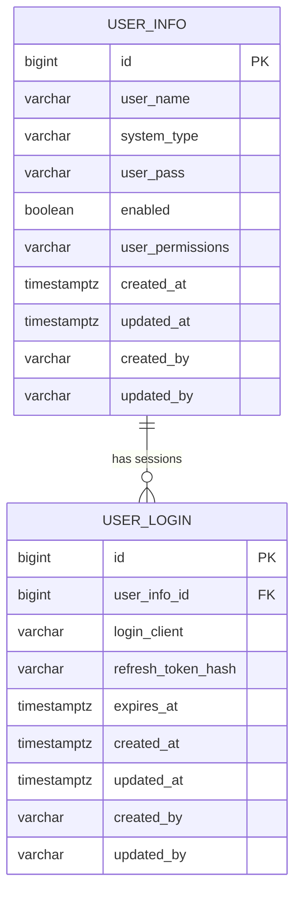

# Manager 数据库设计

## 1. 范围

Manager 当前使用 PostgreSQL，数据库结构由 Flyway 管理。首个迁移：

```text
baosys-manager/baosys-manager-service/src/main/resources/db/migration/
└── V1__init_manager.sql
```

首版一次创建 `user_info`、`user_login`、`permission_change_audit` 三张表和会话清理函数。默认 schema 为 `manager`，由 `MANAGER_DB_SCHEMA` 控制；Flyway 历史表为 `flyway_schema_history_manager`。不启用 baseline-on-migrate，也不需要旧版本升级脚本。

## 2. 实体关系



一个用户可以有零到多个登录会话。删除用户时，数据库通过外键级联删除其会话。

## 3. `user_info`

用途：保存系统账户、密码摘要和直接配置的权限集合。

| 字段 | 类型 | 约束 | 说明 |
|---|---|---|---|
| `id` | BIGINT | PK、IDENTITY | 用户主键 |
| `user_name` | VARCHAR(128) | NOT NULL | 用户名 |
| `system_type` | VARCHAR(32) | NOT NULL、CHECK | 所属系统 |
| `user_pass` | VARCHAR(512) | NOT NULL | BCrypt 密码摘要 |
| `user_permissions` | VARCHAR(1024) | NOT NULL | 逗号分隔权限编码 |
| `enabled` | BOOLEAN | NOT NULL、DEFAULT TRUE | 是否允许登录和刷新 |
| `created_at` | TIMESTAMPTZ | NOT NULL | 创建时间 |
| `updated_at` | TIMESTAMPTZ | NOT NULL | 修改时间 |
| `created_by` | VARCHAR(128) | NOT NULL | 创建人 |
| `updated_by` | VARCHAR(128) | NOT NULL | 修改人 |

约束：

```text
ck_user_info_system_type
  system_type IN ('MANAGER', 'SIMULATION', 'SIMULATORS')

uk_user_info_user_name_system_type
  UNIQUE (user_name, system_type)
```

同一用户名允许在不同系统中存在，但同一系统中必须唯一。

## 4. `user_login`

用途：保存登录客户端和 Refresh Token 的服务端状态。

| 字段 | 类型 | 约束 | 说明 |
|---|---|---|---|
| `id` | BIGINT | PK、IDENTITY | 登录会话主键 |
| `user_info_id` | BIGINT | FK、NOT NULL | 所属用户 |
| `login_client` | VARCHAR(512) | NOT NULL | 客户端描述 |
| `refresh_token_hash` | VARCHAR(64) | UNIQUE、NOT NULL | Refresh Token SHA-256 十六进制摘要 |
| `expires_at` | TIMESTAMPTZ | NOT NULL | 登录时确定的绝对过期时间，刷新时强制校验 |
| `created_at` | TIMESTAMPTZ | NOT NULL | 登录时间 |
| `updated_at` | TIMESTAMPTZ | NOT NULL | 最近更新时间 |
| `created_by` | VARCHAR(128) | NOT NULL | 创建人 |
| `updated_by` | VARCHAR(128) | NOT NULL | 修改人 |

外键：

```text
fk_user_login_user_info
  user_info_id → user_info.id
  ON DELETE CASCADE
```

索引：

```text
idx_user_login_user_info_id(user_info_id)
idx_user_login_expires_at(expires_at)
```

## 5. Java 映射

| 数据库 | Java |
|---|---|
| `user_info` | `UserInfoEntity` |
| `user_login` | `UserLoginEntity` |
| 联表会话查询结果 | `LoginSessionRow` |
| 用户数据访问 | `UserInfoMapper` |
| 会话数据访问 | `UserLoginMapper` |

MyBatis Plus 开启：

```yaml
mybatis-plus:
  configuration:
    map-underscore-to-camel-case: true
```

因此 `user_info_id` 自动映射到 `userInfoId`。

## 6. 权限持久化

权限集合通过 `PermissionPersistenceConverter` 转换。

写入：

```text
Set<String>
  → 按 PermissionCode 顺序排序
  → 逗号连接
  → user_permissions
```

读取：

```text
user_permissions
  → 按逗号拆分
  → trim
  → 去空和去重
  → Set<String>
```

示例：

```text
user:list,user:add,user:update
```

该格式是当前第一阶段实现。角色权限演进参见 [权限模型](permission_model.md)。

## 7. 会话生命周期

### 7.1 创建

登录成功时：

1. 生成随机 Refresh Token。
2. 计算 SHA-256 摘要。
3. 插入 `user_login`。
4. `expires_at = 当前 UTC 时间 + REFRESH_TOKEN_EXPIRE_DAYS`，作为会话绝对有效期，刷新不延长。

### 7.2 刷新

刷新要求会话存在、expires_at 晚于当前时间且账号已启用。事务中先锁用户再锁会话并复核旧摘要，每次刷新轮换摘要、更新 updated_at，但不延长登录时确定的 expires_at。空闲超过一天的会话仍由数据库任务清理。

### 7.3 注销与下线

- 当前客户端注销：按 Refresh Token 摘要删除。
- 指定客户端下线：按 `id + user_info_id` 删除。
- 全部客户端下线：按 `user_info_id` 删除。
- 删除用户：外键级联删除。

### 7.4 空闲清理

初始化迁移会创建数据库函数：

```sql
cleanup_inactive_user_login_sessions()
```

数据库调度每天 00:00 执行一次清理：

```text
updated_at < 当前 UTC 时间 - 1 天
```

满足条件的 `user_login` 会被删除。只要客户端持续刷新 Refresh Token，
`updated_at` 会持续更新，会话就能续租。

PostgreSQL 可使用项目内的 `db/scheduler/pg_cron_user_login_cleanup.sql`
注册 `pg_cron` 任务；若部署环境使用云数据库调度、pgAgent 或外部 DBA 调度，
只需要按日调用该清理函数即可。

### 7.5 在线状态

用户“在线”不是 `user_info` 的持久化字段。当前列表与会话查询仍按以下条件展示：

```text
存在 user_login.expires_at > now 的记录
```

用户分页查询会一次获取当前页全部在线用户 ID，避免 N+1。

该展示条件与 Refresh 资格不是同一个概念：`expires_at` 当前用于列表过滤和后续功能预留，Refresh 资格仍以 `user_login` 记录是否存在为准。

## 8. 主要查询

### 8.1 用户登录查询

```text
user_name = ?
AND system_type = ?
```

由唯一约束保证最多一条记录。

### 8.2 用户分页

可选条件：

```text
user_name LIKE %name%
system_type = ?
```

按 `id ASC` 排序，页码由外部 0 基转换为 MyBatis Plus 1 基。

### 8.3 登录会话分页

`user_login` 与 `user_info` 联表：

```text
expires_at > now
AND userId 精确条件（优先）
或 userName 模糊条件
ORDER BY created_at DESC
```

## 9. 审计字段

`MybatisPlusAuditHandler` 自动填充：

```text
createdAt
updatedAt
createdBy
updatedBy
```

当前默认操作者是 `system`。登录会话创建时，业务代码显式设置 `createdBy` 为用户名。

时间统一使用：

```java
OffsetDateTime.now(ZoneOffset.UTC)
```

数据库使用 `TIMESTAMP WITH TIME ZONE`。

## 10. Flyway 规则

后续迁移命名：

```text
V{version}__{description}.sql
```

例如：

```text
V2__add_user_lock.sql
V3__create_role_tables.sql
```

要求：

1. 已执行迁移禁止修改。
2. 新字段需要明确默认值、可空性和历史数据处理。
3. 数据修复与结构变更按执行顺序拆分。
4. 索引名称、约束名称保持可读。
5. 测试必须能在空 PostgreSQL 中执行全部迁移。

## 11. 数据模型演进

建议按功能需要逐步增加：

### 11.1 账户状态

enabled 已在首版实现，未来可按需增加：

```text
locked
password_changed_at
deleted_at（如采用逻辑删除）
```

### 11.2 角色权限

建议新增独立表：

```text
role
permission
user_role
role_permission
```

不要继续扩大 `user_permissions` 字符串承担角色、组织和数据权限。

### 11.3 操作审计

首版已实现 permission_change_audit 授权审计；更广泛的业务操作审计可按需扩展，与 Entity 基础审计字段区分。

所有演进必须通过新 Flyway 迁移完成。

## 授权审计

`permission_change_audit` 保存 `operator_user_id`、`target_user_id`、前后权限和 enabled、`trace_id`、`occurred_at`，使用 identity 主键以及 `(target_user_id, occurred_at DESC)` 索引。账号删除后审计保留，不设置级联删除外键。默认管理员初始化也写审计。
