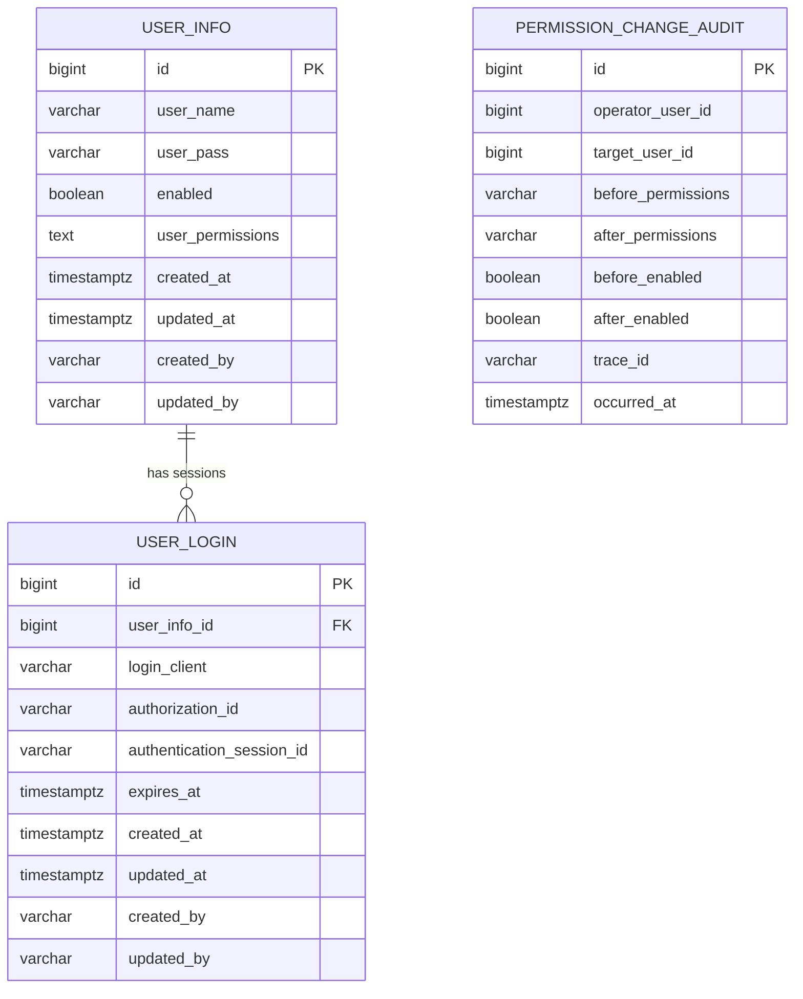

# Manager 数据库设计

V1__init_manager.sql 直接创建最终账户模型：用户名全局唯一，user_permissions 使用 TEXT 保存系统入口和接口权限，user_login 包含 client_id 和授权关联字段。初始化仅适用于空库，详见 [部署指南](../../deployment/oauth2_upgrade.md)。

## 1. 范围

Manager 当前使用 PostgreSQL，数据库结构由 Flyway 管理。首个迁移：

```text
baosys-manager/baosys-manager-service/src/main/resources/db/migration/
└── V1__init_manager.sql
```

首版一次创建 `user_info`、`user_login`、`permission_change_audit` 三张表和会话清理函数。默认 schema 为 `manager`，由 `MANAGER_DB_SCHEMA` 控制；Flyway 历史表为 `flyway_schema_history_manager`。不启用 baseline-on-migrate，也不需要旧版本升级脚本。

## 2. 实体关系



一个用户可以有零到多个登录会话。删除用户时，数据库通过外键级联删除其会话。授权审计表记录操作者及目标 ID，但不设置用户外键，确保删除账户后仍保留历史。

## 3. `user_info`

用途：保存系统账户、密码摘要和直接配置的权限集合。

| 字段 | 类型 | 约束 | 说明 |
|---|---|---|---|
| `id` | BIGINT | PK、IDENTITY | 用户主键 |
| `user_name` | VARCHAR(128) | NOT NULL | 用户名 |
| `user_pass` | VARCHAR(512) | NOT NULL | BCrypt 密码摘要 |
| `user_permissions` | TEXT | NOT NULL | 逗号分隔权限编码 |
| `enabled` | BOOLEAN | NOT NULL、DEFAULT TRUE | 是否允许登录和刷新 |
| `created_at` | TIMESTAMPTZ | NOT NULL | 创建时间 |
| `updated_at` | TIMESTAMPTZ | NOT NULL | 修改时间 |
| `created_by` | VARCHAR(128) | NOT NULL | 创建人 |
| `updated_by` | VARCHAR(128) | NOT NULL | 修改人 |

约束：

```text
uk_user_info_user_name
  UNIQUE (user_name)
```

同一用户名允许在不同系统中存在，但同一系统中必须唯一。

V2 迁移移除 V1 的固定系统名单，系统是否注册由根目录 `baosys-systems.yml` 校验。升级时保留原 V1 文件和已有数据。

## 4. `user_login`

用途：保存登录客户端和 Refresh Token 的服务端状态。

| 字段 | 类型 | 约束 | 说明 |
|---|---|---|---|
| `id` | BIGINT | PK、IDENTITY | 登录会话主键 |
| `user_info_id` | BIGINT | FK、NOT NULL | 所属用户 |
| `client_id` | VARCHAR(128) | NOT NULL | OAuth2 客户端标识，与授权子系统无关 |
| `login_client` | VARCHAR(512) | NOT NULL | 客户端描述 |
| `authorization_id` | VARCHAR(100) | UNIQUE、NOT NULL、FK | 官方 OAuth2Authorization ID，删除授权级联登录记录 |
| `authentication_session_id` | VARCHAR(36) | 可空 | 认证中心 Spring Session ID |
| `expires_at` | TIMESTAMPTZ | NOT NULL | 登录时确定的绝对过期时间，刷新时强制校验 |
| `created_at` | TIMESTAMPTZ | NOT NULL | 登录时间 |
| `updated_at` | TIMESTAMPTZ | NOT NULL | 最近更新时间 |
| `created_by` | VARCHAR(128) | NOT NULL | 创建人 |
| `updated_by` | VARCHAR(128) | NOT NULL | 修改人 |

外键：

```text
fk_user_login_user_info
  user_info_id → user_info.id
  ON DELETE CASCADE
```

索引：

```text
idx_user_login_user_info_id(user_info_id)
idx_user_login_expires_at(expires_at)
```

## 5. Java 映射

| 数据库 | Java |
|---|---|
| `user_info` | `UserInfoEntity` |
| `user_login` | `UserLoginEntity` |
| `permission_change_audit` | `PermissionChangeAuditEntity` |
| 联表会话查询结果 | `LoginSessionRow` |
| 用户数据访问 | `UserInfoMapper` |
| 会话数据访问 | `UserLoginMapper` |
| 授权审计数据访问 | `PermissionChangeAuditMapper` |

MyBatis Plus 开启：

```yaml
mybatis-plus:
  configuration:
    map-underscore-to-camel-case: true
```

因此 `user_info_id` 自动映射到 `userInfoId`。

## 6. 权限持久化

权限集合通过 `PermissionPersistenceConverter` 转换。

写入：

```text
Set<String>
  → 按权限编码字典序稳定排序
  → 逗号连接
  → user_permissions
```

读取：

```text
user_permissions
  → 按逗号拆分
  → trim
  → 去空和去重
  → Set<String>
```

示例：

```text
MGR:user:list,MGR:user:add,MGR:user:update
```

该格式是当前第一阶段实现。角色权限演进参见 [权限模型](permission_model.md)。

## 7. 会话生命周期

### 7.1 创建、刷新与撤销

官方 oauth2_authorization 表保存协议授权与令牌，oauth2_authorization_consent 保存授权确认，spring_session / spring_session_attributes 保存认证中心登录会话。V1 初始化脚本包含对应的 PostgreSQL 表结构。

user_login 作为业务投影保存账户、数字登录 ID、客户端、官方 authorization_id 及认证会话 ID。刷新后同步官方 Refresh Token 的到期时间。踢下线或空闲清理删除投影时，触发器同步撤销授权和认证会话；删除官方授权也会级联删除投影。账户密码、用户名、权限、启停变更及删除时，触发器清理其全部授权和认证会话。

当前初始化结构不包含旧刷新摘要列。官方授权数据包含令牌，应限制库访问权限。

### 7.4 空闲清理

初始化迁移会创建数据库函数：

```sql
cleanup_inactive_user_login_sessions()
```

部署方需配置数据库调度，每天 00:00 执行一次清理；Flyway 仅创建函数，不会自动启用调度：

```text
updated_at < 当前 UTC 时间 - 1 天
```

满足条件的 `user_login` 会被删除。持续刷新会更新 `updated_at`、避免空闲清理，但不会延长登录时确定的 `expires_at`。

PostgreSQL 可使用项目内的 `db/scheduler/pg_cron_user_login_cleanup.sql`
注册 `pg_cron` 任务；若部署环境使用云数据库调度、pgAgent 或外部 DBA 调度，
只需要按日调用该清理函数即可。

### 7.5 在线状态

用户“在线”不是 `user_info` 的持久化字段。当前列表与会话查询仍按以下条件展示：

```text
存在 user_login.expires_at > now 的记录
```

用户分页查询会一次获取当前页全部在线用户 ID，避免 N+1。

`expires_at` 同时用于列表过滤与刷新资格校验。列表展示不是实时连接探测；刷新还必须满足账号启用、会话仍存在及旧令牌摘要匹配。

## 8. 主要查询

### 8.1 用户登录查询

```text
user_name = ?
```

由唯一约束保证最多一条记录。

### 8.2 用户分页

可选条件：

```text
user_name LIKE %name%
'MGR' = ANY(string_to_array(user_permissions, ','))
```

按 `id ASC` 排序，页码由外部 0 基转换为 MyBatis Plus 1 基。

### 8.3 登录会话分页

`user_login` 与 `user_info` 联表：

```text
expires_at > now
AND userId 精确条件（优先）
或 userName 模糊条件
ORDER BY created_at DESC
```

## 9. 审计字段

`MybatisPlusAuditHandler` 自动填充：

```text
createdAt
updatedAt
createdBy
updatedBy
```

当前默认操作者是 `system`。登录会话创建时，业务代码显式设置 `createdBy` 为用户名。

时间统一使用：

```java
OffsetDateTime.now(ZoneOffset.UTC)
```

数据库使用 `TIMESTAMP WITH TIME ZONE`。

### 9.1 授权变更记录

`permission_change_audit` 与 Entity 的基础审计字段分别维护：

| 字段 | 类型 | 说明 |
|---|---|---|
| `id` | BIGINT IDENTITY | 主键 |
| `operator_user_id` | BIGINT | 操作者 ID |
| `target_user_id` | BIGINT | 目标用户 ID |
| `before_permissions` / `after_permissions` | TEXT | 稳定顺序编码的变更前后权限 |
| `before_enabled` / `after_enabled` | BOOLEAN | 变更前后启停状态 |
| `trace_id` | VARCHAR(128) | 请求追踪标识 |
| `occurred_at` | TIMESTAMPTZ | 发生时间 |

全部字段非空，索引为 `(target_user_id, occurred_at DESC)`。创建、删除及权限/启停变化记录审计，默认管理员初始化也写入审计；账号修改和审计处于同一事务。

## 10. Flyway 规则

后续迁移命名：

```text
V{version}__{description}.sql
```

例如：

```text
V2__add_user_lock.sql
V3__create_role_tables.sql
```

要求：

1. 已执行迁移禁止修改。
2. 新字段需要明确默认值、可空性和历史数据处理。
3. 数据修复与结构变更按执行顺序拆分。
4. 索引名称、约束名称保持可读。
5. 测试必须能在空 PostgreSQL 中执行全部迁移。

## 11. 数据模型演进

建议按功能需要逐步增加：

### 11.1 账户状态

enabled 已在首版实现，未来可按需增加：

```text
locked
password_changed_at
deleted_at（如采用逻辑删除）
```

### 11.2 角色权限

建议新增独立表：

```text
role
permission
user_role
role_permission
```

不要继续扩大 `user_permissions` 字符串承担角色、组织和数据权限。

### 11.3 操作审计

首版已实现 permission_change_audit 授权审计；更广泛的业务操作审计可按需扩展，与 Entity 基础审计字段区分。

所有演进必须通过新 Flyway 迁移完成。
