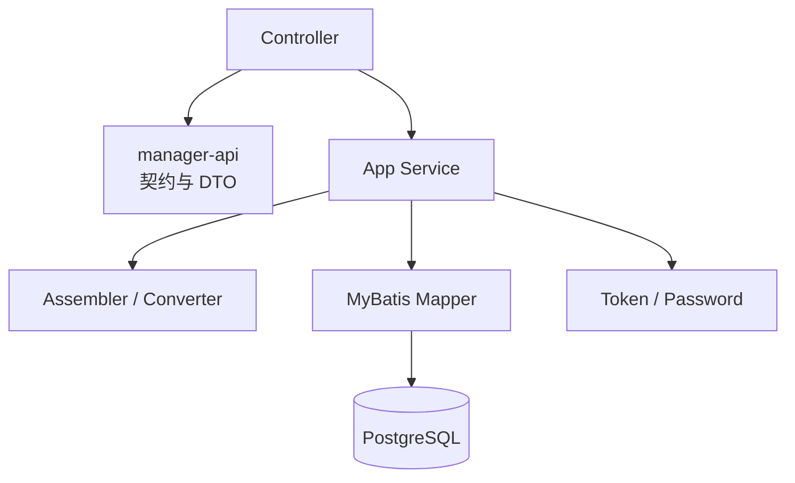

# Manager 模块设计

## 1. 模块定位

`baosys-manager` 是平台管理服务，当前承担：

- 用户身份认证。
- Access Token 和 Refresh Token 管理。
- 用户账户与权限配置。
- 账号启停及授权变更审计。
- 当前登录用户查询。
- 在线登录会话查询。
- 单客户端或全部客户端下线。

Manager 是独立可启动业务服务，不承担网关路由和前端静态资源托管。

相关文档：

- [认证与会话设计](auth_and_session.md)
- [权限模型](permission_model.md)
- [数据库设计](database_design.md)
- [系统总体架构](../../architecture/system_architecture.md)
- [Common 模块说明](../../../baosys-common/README.md)

## 2. Maven 模块

```text
baosys-manager
├── baosys-manager-api
└── baosys-manager-service
```

### 2.1 `baosys-manager-api`

对外公开：

```text
baosys.manager.api
├── AuthApi
├── UserApi
├── LoginSessionApi
├── dto
│   ├── LoginRequest
│   ├── CurrentUserResponse
│   ├── UserCreateRequest
│   ├── UserUpdateRequest
│   ├── UserResponse
│   ├── LoginClientResponse
│   └── LoginSessionResponse
└── SystemCatalogApi（返回 SystemDefinition 目录）
```

API Jar 依赖：

- `baosys-common-api`
- 可选 `spring-web`
- 可选 `jakarta.validation-api`

API Jar 不包含 Controller、业务服务、数据库实体或 FeignClient。

### 2.2 `baosys-manager-service`

可启动 Spring Boot 服务，依赖自己的 API Jar 和 `baosys-common`。

```text
baosys.manager
├── ManagerApplication
├── app
│   ├── controllers
│   ├── services
│   │   └── impl
│   ├── assembler
│   ├── config
│   │   └── web
│   ├── error
│   └── model
└── infra
    ├── database
    │   ├── entity
    │   ├── mapper
    │   └── converter
    ├── security
    └── config
```

当前业务复杂度适合简单分层：App Service 直接编排 Mapper 和基础设施组件，不额外创建空的 Domain/Agent 层。

## 3. 依赖与调用方向



约束：

1. Controller 实现 API 接口。
2. Controller 不直接访问 Mapper。
3. App Service 定义事务边界。
4. Entity 不离开 Service 实现层。
5. HTTP Response 由 Assembler 或 App Service 从 Entity 转换。

## 4. HTTP API

外部网关前缀：

```text
/api/baosys-manager
```

服务内部前缀：

```text
/baosys-manager
```

### 4.1 认证接口

| 方法 | 外部路径 | 说明 | 是否公开 |
|---|---|---|---:|
| POST | `/api/baosys-manager/v1/auth/login` | 用户登录 | 是 |
| POST | `/api/baosys-manager/v1/auth/refresh` | 轮换刷新令牌并签发访问令牌 | 是 |
| POST | `/api/baosys-manager/v1/auth/logout` | 删除刷新会话并清理 Cookie | 是 |

### 4.2 用户接口

| 方法 | 外部路径 | 说明 | 权限 |
|---|---|---|---|
| GET | `/api/baosys-manager/v1/users/me` | 当前登录用户 | 已认证 |
| GET | `/api/baosys-manager/v1/users` | 分页查询用户 | `user:list` |
| POST | `/api/baosys-manager/v1/users` | 新增用户 | `user:add` |
| PUT | `/api/baosys-manager/v1/users` | 修改用户 | `user:update` |
| DELETE | `/api/baosys-manager/v1/users/{id}` | 删除用户 | `user:delete` |
| GET | `/api/baosys-manager/v1/users/{id}/login-clients` | 查询用户登录客户端 | `user:session:list` |
| DELETE | `/api/baosys-manager/v1/users/{id}/login-clients/{loginId}` | 指定客户端下线 | `user:session:kick` |
| DELETE | `/api/baosys-manager/v1/users/{id}/login-clients` | 全部客户端下线 | `user:session:kick` |

用户列表查询参数：

| 参数 | 类型 | 默认值 | 说明 |
|---|---|---:|---|
| `name` | String | 空 | 用户名模糊查询 |
| `systemType` | String | 空 | 系统类型精确查询，目录在根配置文件中声明 |
| `page` | int | 0 | 从 0 开始 |
| `size` | int | 20 | 1～200 |

### 4.3 登录会话接口

| 方法 | 外部路径 | 说明 | 权限 |
|---|---|---|---|
| GET | `/api/baosys-manager/v1/login-sessions` | 分页查询有效会话 | `user:session:list` |

查询参数：

| 参数 | 类型 | 说明 |
|---|---|---|
| `userId` | Long | 用户精确查询，优先级高于用户名 |
| `userName` | String | 用户名模糊查询 |
| `page` | int | 从 0 开始 |
| `size` | int | 1～200 |

## 5. 应用服务

### 5.1 `AuthAppService`

```text
login(LoginRequest)
refresh(String refreshToken)
logout(String refreshToken)
```

负责认证、令牌签发、刷新令牌轮换和注销。

### 5.2 `UserAppService`

```text
currentUser(long userId)
list(name, systemType, page, size)
create(UserCreateRequest, long operatorUserId)
update(UserUpdateRequest, long operatorUserId)
delete(long id, long operatorUserId)
loginClients(long userId)
kickClient(long userId, long loginId)
kickAllClients(long userId)
```

负责用户生命周期和指定用户的会话管理。创建、更新、删除操作的操作者 ID 由 Controller 从认证 Principal 获取，不由请求体指定。

### 5.3 `LoginSessionAppService`

```text
list(userId, userName, page, size)
```

负责跨用户的有效会话分页查询。

## 6. 核心业务规则

### 6.1 用户

1. 用户名保存前去除首尾空白。
2. 同一 `systemType` 下用户名必须唯一。
3. 新增用户密码长度为 8～128。
4. 修改时密码为空表示不修改密码。
5. 权限、启停状态、密码或系统类型变化时删除该用户全部刷新会话。
6. 删除用户时数据库级联删除登录会话。
7. Manager 系统用户至少配置一个有效权限。
8. 用户列表中的 `status` 当前表示是否存在未过期登录会话，不是账户启停状态。
9. `enabled` 表示账号启停，创建时省略默认为 `true`，更新时省略保留原值；禁用账号不能登录或刷新。
10. 创建、删除及权限/启停变更写入 `permission_change_audit`，审计与用户修改处于同一事务；删除用户后保留审计。

### 6.2 当前用户

JWT 的 `sub` 保存用户 ID。`/users/me` 根据该 ID 重新查询数据库，返回当前系统类型和当前权限，不直接把令牌中的展示信息作为最终业务数据。

### 6.3 登录会话

1. 只查询 `expires_at` 晚于当前 UTC 时间的会话。
2. 用户列表一次查询整页在线用户 ID，避免逐用户 N+1 查询。
3. 单客户端下线必须同时匹配 `loginId` 和 `userId`。
4. 注销接口保持幂等；缺少刷新 Cookie 时仍可完成本地退出。
5. 刷新先锁用户再锁会话，校验账号启用、原摘要和到期时间，轮换摘要但不延长绝对到期时间。
6. 撤销刷新会话不立即撤销已签发 JWT，Manager 的 Access Token 默认有效期为 1800 秒。

## 7. 事务边界

| 操作 | 事务 |
|---|---|
| 用户和会话查询 | `@Transactional(readOnly = true)` |
| 登录、刷新、注销 | `@Transactional` |
| 用户新增、修改、删除 | `@Transactional` |
| 客户端下线 | `@Transactional` |
| 默认管理员初始化 | `@Transactional` |

事务位于 App Service 或启动初始化器，不放在 Controller。

## 8. 统一响应与异常

成功响应：

```json
{
  "code": "SUCCESS",
  "message": "操作成功",
  "data": {},
  "traceId": "request-trace-id",
  "timestamp": "UTC timestamp"
}
```

主要错误码：

| 错误码 | HTTP 状态 | 场景 |
|---|---:|---|
| `REQUEST_400_001` | 400 | 方法参数错误 |
| `AUTH_400_001` | 400 | 登录请求或请求体错误 |
| `AUTH_401_001` | 401 | 凭据错误、访问令牌缺失或过期 |
| `AUTH_403_001` | 403 | 无权限或刷新状态失效 |
| `USER_400_001` | 400 | 用户名为空 |
| `USER_400_002` | 400 | 权限配置错误 |
| `USER_400_003` | 400 | 修改密码长度错误 |
| `USER_404_001` | 404 | 用户不存在 |
| `USER_409_001` | 409 | 用户名重复 |
| `LOGIN_404_001` | 404 | 登录客户端不存在 |
| `SYS_500_001` | 500 | 未预期异常 |

所有响应通过 `TraceIds.current()` 关联请求日志。

## 9. 配置和启动

默认值：

```text
spring.application.name = baosys-manager
server.port = 9090
server.servlet.context-path = /baosys-manager
```

完整配置参见：

- [环境变量说明](../../deployment/environment_variables.md)
- [本地开发指南](../../deployment/local_development.md)

## 10. 测试现状

当前测试包括：

- Auth 和 User App Service 单元测试。
- Auth 和 User Controller 测试。
- 基于 Testcontainers PostgreSQL 的认证与用户集成测试。
- JWT、密码和权限转换公共模块测试。
- 网关认证与路由集成测试。

数据库集成测试继承 `PostgreSqlIntegrationTest`，使用 `postgres:17-alpine`，并由 Flyway 初始化空库。
根 POM 的 Surefire 默认排除 `*IntegrationTest`。已配置的 `integration-tests` profile 使用 Failsafe 运行集成测试；在仓库根目录执行：

```shell
mvn -Pintegration-tests -pl :baosys-manager-service -am verify "-Dskip.frontend=true"
```

`AccountLifecycleIntegrationTest` 覆盖 V1 初始化及删除后审计保留、并发刷新只能成功一次、禁用与刷新竞争后的会话撤销。

当前待补：

- `LoginSessionController` 独立测试。
- 默认管理员初始化的更多异常分支。
- 用户名唯一约束竞争测试。
- 审计字段和异常码完整性测试。

## 11. 下一阶段建议

优先演进：

1. 在已有账户启停基础上增加锁定状态。
2. 将 `UserResponse.status` 明确改名为 `online`。
3. 增加修改密码和管理员重置密码。
4. 从用户直配权限演进到角色权限。
5. 在已有账号授权审计之外按需扩展业务操作审计。
6. 形成系统配置后端闭环。

这些能力尚未实现，不应在调用方中预设其接口。
