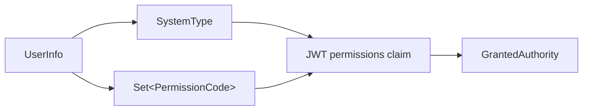
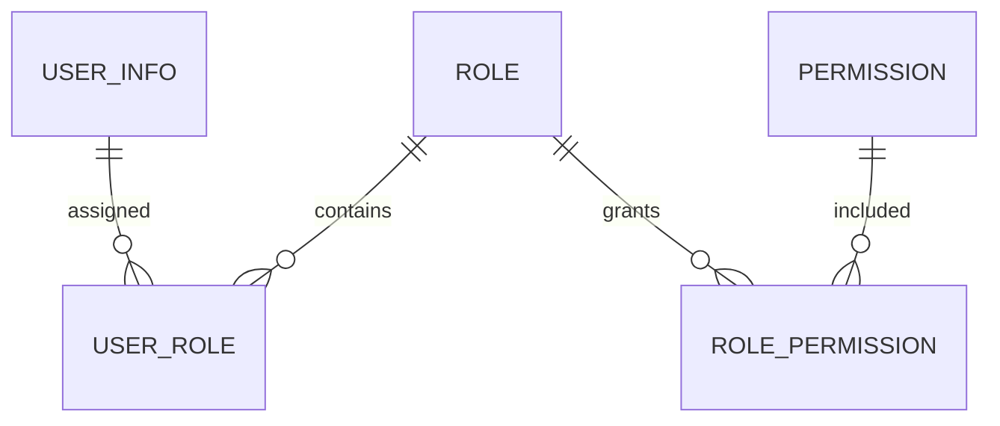

# Manager 权限模型

## 1. 当前模型

当前版本采用“用户直接配置权限”模型：



当前没有角色、组织、租户或数据权限表。权限集合直接保存在 `user_info.user_permissions`。

## 2. 系统类型

公开枚举 `SystemType`：

| 值 | 含义 | 当前权限目录 |
|---|---|---|
| `MANAGER` | 后台管理平台 | 已实现 |
| `SIMULATION` | 声纳仿真平台 | 预留 |
| `SIMULATORS` | 试验平台 | 预留 |

同一用户名可以存在于不同系统类型；数据库唯一约束是：

```text
(user_name, system_type)
```

登录时必须同时提交用户名、密码和系统类型。

## 3. 权限编码目录

当前 Manager 权限：

| 权限编码 | 用途 |
|---|---|
| `user:list` | 查询用户列表 |
| `user:add` | 新增用户 |
| `user:update` | 修改用户 |
| `user:delete` | 删除用户 |
| `user:session:list` | 查询登录会话 |
| `user:session:kick` | 指定或全部客户端下线 |

后端权威目录位于：

```text
baosys-manager-service
└── app.model.PermissionCode
```

前端展示目录位于：

```text
baosys-manager-ui
└── src/constants/permissions.ts
```

两侧编码必须保持一致。当前 `SIMULATION` 和 `SIMULATORS` 的前端权限数组为空。

## 4. 权限配置规则

新增或修改用户时：

1. `systemType` 和 `permissions` 不能为空。
2. 每个权限必须属于该 `systemType` 的后端权限目录。
3. 已定义权限目录的系统至少选择一个权限。
4. 尚未定义权限目录的系统允许空权限集合。
5. 保存时按 `PermissionCode` 枚举顺序稳定排序。
6. 读取时去除重复项和空白。

非法权限返回：

```text
USER_400_002 权限配置错误
```

## 5. 持久化格式

当前权限使用英文逗号连接：

```text
user:list,user:add,user:update
```

转换由 `PermissionPersistenceConverter` 负责：

```text
Set<String> → encode → VARCHAR(1024)
VARCHAR(1024) → decode → Set<String>
```

Controller、前端和其他模块不直接解析该数据库格式。

## 6. JWT 权限

登录和刷新时，服务合并：

```text
用户权限集合
    +
SystemType 名称
```

例如：

```json
{
  "permissions": [
    "MANAGER",
    "user:list",
    "user:add"
  ]
}
```

`JwtPermissionConverter` 将每项转换为同名 `GrantedAuthority`。当前 `authority-prefix` 为空，因此业务代码直接使用：

```java
@PreAuthorize("hasAuthority('user:add')")
```

系统类型权限用于标识用户可进入的子系统；细粒度权限控制具体操作。

## 7. 服务端授权矩阵

| 接口 | 授权规则 |
|---|---|
| `GET /v1/users/me` | 已认证 |
| `GET /v1/users` | `user:list` |
| `POST /v1/users` | `user:add` |
| `PUT /v1/users` | `user:update` |
| `DELETE /v1/users/{id}` | `user:delete` |
| `GET /v1/users/{id}/login-clients` | `user:session:list` |
| `DELETE /v1/users/{id}/login-clients/{loginId}` | `user:session:kick` |
| `DELETE /v1/users/{id}/login-clients` | `user:session:kick` |
| `GET /v1/login-sessions` | `user:session:list` |

授权注解位于 Controller 实现方法，契约 Jar 不绑定平台授权规则。

## 8. 前端权限控制

`CurrentUserResponse.permissions` 返回数据库中的当前用户权限，不依赖浏览器自行解析 JWT。

前端当前控制：

- 新增用户按钮：`user:add`
- 编辑用户按钮：`user:update`
- 删除用户按钮：`user:delete`
- 查看登录客户端：`user:session:list`
- 客户端下线：`user:session:kick`

前端控制只改善界面体验，不能替代服务端 `@PreAuthorize`。

## 9. 新增权限的步骤

在当前直配模型下增加权限时：

1. 在 `PermissionCode` 增加系统类型和权限编码。
2. 在对应 Controller 方法增加或调整 `@PreAuthorize`。
3. 在前端 `permissions.ts` 增加相同编码和国际化 Key。
4. 在中英文语言文件增加显示名称。
5. 更新本文权限目录和授权矩阵。
6. 增加有权限、无权限两类测试。
7. 如已有管理员需要新权限，通过数据迁移或管理界面显式分配。

权限编码命名建议：

```text
{resource}:{action}
{resource}:{subresource}:{action}
```

例如：

```text
role:list
role:add
user:password:reset
system:config:update
```

编码一旦发布应保持稳定，显示名称可以通过国际化调整。

## 10. 当前边界

当前模型的特点：

- 实现简单，适合用户量和权限量较小的第一阶段。
- 每个用户独立配置，无法批量复用权限集合。
- 权限目录在后端和前端各维护一次。
- 不能表达角色继承、组织范围和数据范围。
- 权限字段不适合复杂查询和审计。

这些是当前功能边界，不影响第一阶段用户管理闭环。

## 11. 角色模型演进建议

当出现以下任一情况时，建议升级：

- 大量用户拥有相同权限组合。
- 需要批量调整某类用户权限。
- 需要角色分级或系统内置角色。
- 需要组织、租户或数据范围。
- 需要完整授权变更审计。

目标关系：



演进原则：

1. `PermissionCode` 或权限表仍是最终授权编码来源。
2. JWT 继续携带扁平化的最终权限集合。
3. Controller 的 `hasAuthority` 表达式保持不变。
4. 前端继续消费 `CurrentUserResponse.permissions`。
5. 角色只改变权限计算和管理方式，不破坏现有业务 API。
